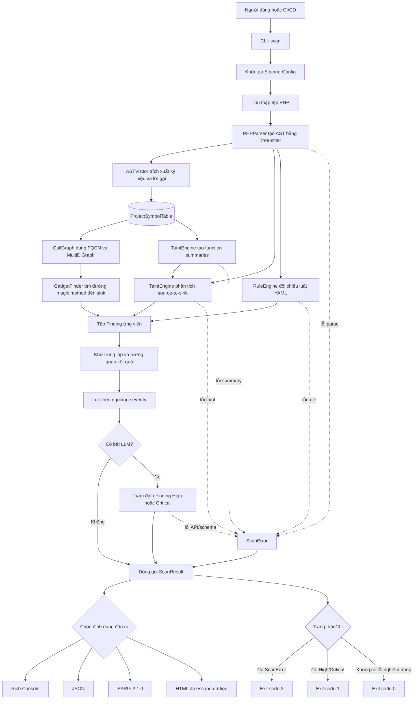
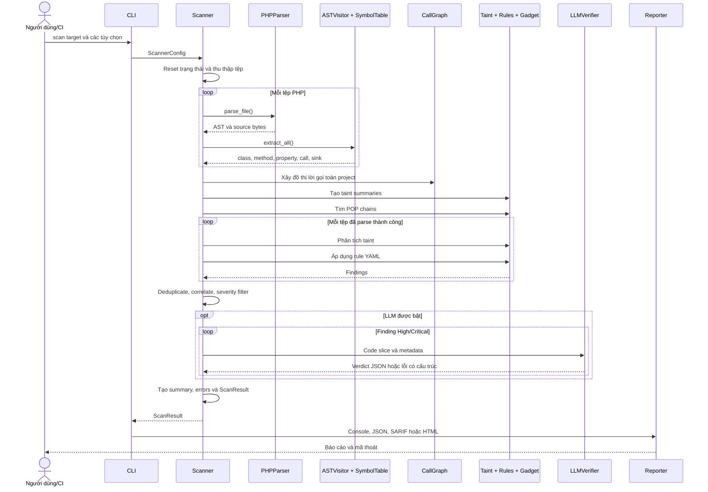

# Sơ đồ luồng hoạt động của PHP Deserialization SAST

## 1. Luồng xử lý tổng thể

## 2. Luồng hoạt động chi tiết

## 3. Vai trò của từng giai đoạn

| Giai đoạn | Đầu vào | Xử lý | Đầu ra |
|---|---|---|---|
| Thu thập | Đường dẫn tệp/thư mục | Lọc phần mở rộng PHP và thư mục loại trừ | Danh sách tệp đã sắp xếp |
| Parse | Mã nguồn PHP | Tree-sitter tạo cây cú pháp | AST và source bytes |
| Trích xuất | AST | Lấy namespace, FQCN, lớp, hàm, phương thức, thuộc tính và sink | ProjectSymbolTable |
| Call graph | Symbol table | Tạo đa cạnh cho direct call, dynamic dispatch và magic method | MultiDiGraph |
| Taint | AST và summaries | Theo dấu nguồn dữ liệu đến `unserialize()` hoặc Phar sink | Finding và dataflow trace |
| Rule | AST và YAML | So khớp pattern trên các node phù hợp | Custom-rule Finding |
| Gadget | Call graph | DFS có giới hạn từ magic method tới sink | POP candidates và blueprint |
| Hậu xử lý | Tất cả Finding | Tương quan, khử trùng lặp và lọc severity | Danh sách Finding cuối |
| LLM | Finding High/Critical | Cắt lát mã, gọi provider và kiểm tra JSON nghiêm ngặt | `llm_verification` hoặc ScanError |
| Báo cáo | ScanResult | Chuyển sang giao diện hoặc định dạng trao đổi | Console, JSON, SARIF, HTML |

## 4. Nguyên tắc diễn giải kết quả

- Taint finding cho biết công cụ tìm thấy một đường dữ liệu khả nghi; nó chưa chứng minh payload khai thác thành công.
- POP chain là ứng viên đường gọi từ magic method tới sink. Khả năng khai thác còn phụ thuộc khả năng điều khiển thuộc tính, kiểu, autoload và điều kiện runtime.
- Rule finding là kết quả so khớp heuristic, cần được đối chiếu với ngữ cảnh chương trình.
- LLM chỉ bổ sung nhận định và không xóa Finding gốc.
- Nếu một pha lỗi, lỗi được đưa vào `ScanError`; báo cáo không được xem là một lần quét sạch hoàn chỉnh.

