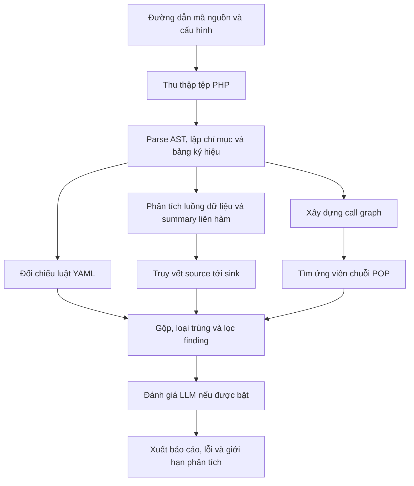

# BÁO CÁO NGẮN: CẤU TRÚC VÀ LUỒNG HOẠT ĐỘNG CỦA CÔNG CỤ

## 1. Mục tiêu và kiến trúc

**PHP Deserialization SAST** là công cụ phân tích tĩnh viết bằng Python, hỗ trợ
rà soát nguy cơ PHP Insecure Deserialization trong mã nguồn. Công cụ đọc và phân
tích chương trình mà không thực thi ứng dụng PHP, kết hợp ba hướng: truy vết dữ
liệu không tin cậy, đối chiếu luật cú pháp và tìm ứng viên chuỗi gadget POP
(Property-Oriented Programming).

Kiến trúc được chia thành các mô-đun, do `scanner.py` điều phối:

| Thành phần | Vai trò |
|---|---|
| `cli.py`, `config.py` | Nhận đường dẫn, phiên bản PHP, chế độ quét và giới hạn tài nguyên. |
| `core/parser.py`, `ast_visitor.py`, `symbol_table.py` | Dùng Tree-sitter tạo cây cú pháp AST, lập chỉ mục và thu thập hàm, lớp, phương thức, quan hệ kế thừa. |
| `core/dataflow.py`, `source_models.py`, `taint_engine.py` | Phân tích phép gán và luồng liên hàm; mô hình hóa nguồn dữ liệu; tạo finding cùng trace từ source tới sink. |
| `core/call_graph.py`, `gadget_finder.py` | Xây dựng đồ thị lời gọi và tìm đường từ magic method tới thao tác nguy hiểm. |
| `rules/` | Nạp luật YAML, đối chiếu mẫu trên AST và sinh cảnh báo cú pháp. |
| `llm/` | Tùy chọn trích đoạn mã và gửi LLM đánh giá bổ sung các finding phù hợp. |
| `models.py`, `reporters/` | Chuẩn hóa dữ liệu và xuất console, JSON, SARIF hoặc HTML. |
| `tests/`, thư mục `scripts/` ngoài package | Kiểm thử hồi quy, chạy đánh giá và tổng hợp kết quả. |

## 2. Luồng xử lý

Sơ đồ dưới đây thể hiện quan hệ dữ liệu giữa các giai đoạn; các nhánh không có
nghĩa là được thực thi song song.

**Bước 1 – Thu thập và phân tích cú pháp.** Công cụ duyệt thư mục đích, chọn các
tệp có phần mở rộng PHP được hỗ trợ và ghi nhận lỗi truy cập. Mỗi tệp được parse
thành AST, sau đó trích xuất thông tin vào bảng ký hiệu chung. Tệp chỉ chứa dữ
liệu, không cần phân tích liên tệp, có thể được xử lý luật rồi giải phóng AST.

**Bước 2 – Xây dựng mô hình chương trình.** Công cụ tạo call graph phục vụ POP
và mô hình dataflow phục vụ taint. Summary của hàm mô tả sự phụ thuộc của giá trị
trả về và sink vào đầu vào. Hàng đợi theo quan hệ caller/callee cập nhật summary
đến khi hội tụ hoặc chạm giới hạn.

**Bước 3 – Phát hiện điểm đáng nghi.** Taint engine theo dõi dữ liệu từ request,
nguồn framework được mô hình hóa hoặc tham số API trong library mode tới
`unserialize()` và các thao tác filesystem liên quan Phar. Phân tích xét phép
gán, trường mảng, lời gọi hàm, tùy chọn `allowed_classes`, một số guard và tiền tố
đường dẫn. Luật YAML và bộ tìm POP cung cấp hai nhóm bằng chứng bổ sung.

**Bước 4 – Tổng hợp và xuất kết quả.** Scanner loại trùng, lọc theo mức độ nghiêm
trọng và, nếu bật, bổ sung đánh giá LLM. Báo cáo chứa finding, vị trí mã nguồn,
trace, mức độ tin cậy, sink inventory, chuỗi gadget, thời gian, lỗi và giới hạn.

## 3. Diễn giải kết quả và giới hạn

Finding có trace source–sink khác với khớp luật cú pháp hoặc ứng viên POP.
Library mode giả định tham số API công khai có thể bị kiểm soát, không chứng minh
có caller nhận đầu vào attacker. `guarded_flow_review` yêu cầu xem xét điều kiện;
`configured_local_path_review` ghi giả định về cấu hình đường dẫn. Hai trạng thái
này không xác nhận tính an toàn hoặc khả năng khai thác.

Công cụ chưa mô hình hóa đầy đủ alias/heap, lời gọi động và mọi hành vi framework.
Phiên bản PHP ảnh hưởng cách diễn giải Phar. Lỗi parse, giới hạn call graph hoặc
budget tìm POP được ghi rõ; hoàn tất quét không đồng nghĩa đã phân tích mọi đường
đi. Vì vậy, báo cáo là cơ sở hỗ trợ kiểm tra mã nguồn, cần xác minh ngữ cảnh thực
tế trước khi kết luận lỗ hổng.
