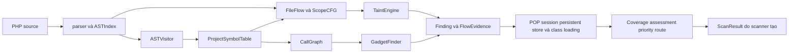

# Báo cáo chi tiết chức năng và nội dung thư mục core

**Đối tượng:** `php_deserial_sast/core` tại `D:\đồ án`, đọc ngày 30/10/2026. **Phạm vi:** 26 tệp Python, khoảng 6.729 dòng theo nội dung tệp hiện tại. Báo cáo mô tả mã nguồn đang có; các kết luận về khả năng khai thác được giữ ở mức bằng chứng tĩnh. Thư mục `core` không có `__init__.py`; các module được import trực tiếp bằng tên `php_deserial_sast.core.<module>`.

## 1. Vị trí của core trong hệ thống

`scanner.py` là bộ điều phối bên ngoài `core`. Nó thu thập tệp, dùng parser và visitor để dựng symbol table, tạo `FlowProject` nếu bật taint, tạo `CallGraph` nếu bật POP, chạy `TaintEngine` và các rule, rồi gọi những bộ chú giải chứng cứ trước khi dựng `ScanResult`. `models.py` chứa schema kết quả; `rules/` chứa engine luật YAML; `reporters/` xuất định dạng. Vì vậy `core` chứa phần lớn mô hình chương trình và logic phát hiện, nhưng không tự thực hiện toàn bộ vòng đời CLI hay xuất báo cáo.

Các mũi tên chỉ sự phụ thuộc dữ liệu chính, không hàm ý mọi module chạy trong mọi cấu hình. `--no-taint`, `--no-gadgets`, `--no-rules` và `--experimental-side-effects` thay đổi các nhánh được gọi. Một số module trả về finding; các module khác chỉ bổ sung metadata vào finding đã có. Phân biệt này quan trọng khi giải thích số lượng cảnh báo.

## 2. Nhóm cú pháp và mô hình ký hiệu

### 2.1. `parser.py`

**Nhiệm vụ.** Bọc Tree-sitter PHP qua `PHPParser.parse_source()` và `parse_file()`, trả AST root cùng byte nguồn gốc. Nó không tự quyết định một lời gọi có nguy hiểm hay không. Khi grammar báo lỗi, parser thử chuẩn hóa có giới hạn cho ký tự NUL trong chuỗi, `readonly` ở mã cũ và cú pháp offset chuỗi bằng ngoặc nhọn. Byte gốc vẫn được trả về để snippet và vị trí không bị dịch.

**Nội dung chính.** `walk_nodes()` duyệt AST bằng `TreeCursor`; `find_nodes_by_type()`, `iter_child_nodes()` và `find_child_by_type()` phục vụ các engine khác. `get_node_text()`, `get_node_location()`, `get_code_snippet()` chuyển node thành văn bản/vị trí. `ASTIndex` duyệt cây một lần, gom các loại node cần tìm và đếm node cho giới hạn tài nguyên. `needs_project_analysis` cho scanner biết tệp có cần giữ AST để phân tích liên tệp không. `ASTIndex.find()` giữ thứ tự nguồn, chỉ trộn/sắp xếp khi truy vấn nhiều loại node.

**Đầu vào/đầu ra và giới hạn.** Đầu vào là byte PHP hoặc đường dẫn; đầu ra là node, byte nguồn và chỉ mục. Tree-sitter có thể phục hồi sau lỗi cú pháp, nên scanner phải ghi `ScanError(parse)` thay vì coi toàn bộ phần phục hồi là chắc chắn. Chỉ mục giữ node AST trong bộ nhớ, góp phần vào RAM của dự án lớn.

### 2.2. `ast_visitor.py`

**Nhiệm vụ.** `ASTVisitor.extract_all()` chuyển AST của một tệp thành khai báo cấp dự án: namespace, `use`, class, trait, property, method, function và thông tin lời gọi. Nó điền `ProjectSymbolTable` để dataflow và POP dùng chung. Các phương thức `_extract_classes()`, `_extract_properties()`, `_extract_methods()`, `_extract_functions()` xử lý từng loại khai báo; `_analyze_method_body()` ghi lời gọi và truy cập thuộc tính.

**Nội dung bảo mật.** Các tập `RCE_SINKS`, `DYNAMIC_INVOKE_SINKS`, `FILE_WRITE_SINKS`, `FILE_DELETE_SINKS`, `FILE_READ_SINKS`, `INCLUDE_SINKS` và `PHAR_TRIGGER_SINKS` phân loại thao tác cho đồ thị POP. `categorize_sink()` trả loại tác động, còn `_categorize_call_sink()` xét hình dạng lời gọi. `CallExpressionInfo` có thể ghi nguồn callback lấy từ thuộc tính, nhưng đây là dấu hiệu cú pháp, chưa chứng minh đối tượng được khôi phục hoặc tham số callback bị kiểm soát.

**Quan hệ.** Nhận `ASTIndex` từ `parser.py`, ghi các dataclass trong `symbol_table.py`. Nếu một tệp thiếu AST index, visitor có thể tự tạo nó. Việc ghi lời gọi ở pha này phục vụ POP, khác với truy vết giá trị tại điểm dùng của `dataflow.py`.

### 2.3. `symbol_table.py`

**Nhiệm vụ.** Định nghĩa `PropertySymbol`, `CallExpressionInfo`, `MethodSymbol`, `ClassSymbol`, `FunctionSymbol` và `ProjectSymbolTable`. Các dataclass lưu tên đầy đủ, namespace, visibility, type hint, default value, quan hệ kế thừa/trait/interface, vị trí và lời gọi. `POP_ENTRY_MAGIC_METHODS` giới hạn điểm bắt đầu POP trực tiếp ở `__destruct`, `__wakeup`, `__unserialize`; các magic method khác cần trigger riêng.

**Cơ chế.** `add_class()` và `add_function()` lập bảng; `resolve_class_name()` dùng namespace và `use` của tệp; `resolve_inheritance()` trả chuỗi lớp cha; `find_classes_with_method()` và `get_all_unique_classes()` phục vụ dispatch và tìm gadget. Bảng này là danh sách khai báo trong mã được quét, không phải tập class chắc chắn được nạp ở runtime. Một tên class trùng hoặc thiếu file include phải được xử lý thận trọng ở lớp chứng cứ.

### 2.4. `bindings.py`

**Nhiệm vụ.** Mô hình hóa binding của `foreach` theo giá trị, gồm biến nhận phần tử, biến key và destructuring bằng `list`/`[]`. `foreach_bindings()` trả cặp node biến với đường trường từ phần tử iterable; `FieldKind.ARRAY_KEY` đánh dấu trường key.

**Giới hạn.** Hàm trả `None` cho hình dạng không hiểu chắc chắn, như key động hoặc binding phức tạp. `dataflow.py` dùng kết quả để ánh xạ phép ghi vào đúng trường; `control_flow.py` dùng nó khi xem `foreach` có đủ điều kiện bật CFG thử nghiệm. Nó không mô hình hóa đầy đủ alias do `foreach` tham chiếu.

## 3. Nhóm CFG và luồng dữ liệu

### 3.1. `control_flow.py`

**Nhiệm vụ.** `ScopeCFG` dựng đồ thị luồng điều khiển theo scope. Nó theo dõi entry, cạnh, vị trí node, exit, nhánh, vòng lặp và một phần luồng ngoại lệ. `is_reachable()`, `may_reach()`, `dominates()` và `reaching_definitions()` giúp loại định nghĩa đã bị ghi đè hoặc nhánh không tới được điểm dùng. `effect_can_escape()` kiểm tra một may-write có thể rời hàm mà không bị ghi đè chắc chắn. Hàm `coverage(project)` tổng hợp scope CFG có hỗ trợ hoặc fallback.

**Thiết kế bảo toàn.** CFG không phải bộ giải PHP đầy đủ. Với `goto`, `yield`, lỗi AST, scope quá lớn hoặc cấu trúc chưa hỗ trợ, `supported=False` và engine quay về suy luận từ vựng thận trọng. `foreach` CFG mặc định tắt; ngân sách node ngăn một scope quá lớn chiếm toàn bộ tài nguyên. `catch`/`finally` và loại ngoại lệ vẫn là xấp xỉ. Thông tin fallback được đưa vào coverage của finding.

### 3.2. `dataflow.py`

**Nhiệm vụ.** Đây là module lõi lớn nhất. Dataclass bất biến `Flow` giữ loại nguồn, origin, chỉ số tham số, đường trường, trace và cờ bất định; `Sink` giữ vị trí sink, đối số, guard và giả định đường dẫn; `Function` gắn AST với scope. `FileFlow` lập chỉ mục phép gán, lời gọi, alias, CFG và đánh giá giá trị tại điểm dùng. `FlowProject` gom nhiều `FileFlow`, giải tên callee và tính summary liên hàm.

**Đường xử lý chính.** `FileFlow._index()` gán node vào scope, ghi phép gán và call site. `access()` tạo đường truy cập biến/mảng/thuộc tính; `read()`/`_read()` tìm định nghĩa có thể tới điểm dùng; `evaluate()` phân tích biểu thức; `_call_value()` và `bind()` nối tham số/giá trị trả về với callee. `direct_sinks()` nhận diện sink trong hàm, `forwarded_sinks()` truyền sink qua caller. `review_conditions()` và các hàm guard ghi điều kiện có thể chặn payload. `unserialize_safe()` xét trường hợp chính sách class loại object; các hàm Phar xét đường dẫn và runtime PHP.

**Summary và ngân sách.** `FlowProject.build()` lập phụ thuộc caller–callee, chia thành phần liên thông mạnh bằng `summary_components()` rồi dùng worklist để cập nhật return, sink và effect summary. `bounded_fields()` giới hạn độ sâu trường; `compact_sink_summaries()` giới hạn biến thể diễn giải guard mà không gộp nguồn khác nhau. Return/effect summary được yêu cầu theo nhu cầu ở chế độ mặc định. Side effects qua tham chiếu/global/property chỉ bật bằng cờ thử nghiệm; có giới hạn mặc định 60 giây và 25.000 lần bind. Khi vượt, `SideEffectBudgetExceeded` được scanner bắt để dựng lại summary cơ bản, ghi `budget_fallback`. Trong mã lớn, summary có thể vẫn cần nhiều RAM; fallback không chứng minh phần side effects đã được bao phủ.

**Quan hệ.** Module dùng `ScopeCFG`, `FrameworkDispatch`, `object_effects`, `source_models`, `guard_models` và `bindings`. `TaintEngine` đọc kết quả `FlowProject` để tạo finding. Sự tách biệt `Flow` nội bộ và `FlowEvidence` công bố giúp giữ phép giải riêng với schema báo cáo.

### 3.3. `source_models.py`

**Nhiệm vụ.** Cung cấp mô hình nguồn có tên rõ ràng: `is_framework_request_source()` nhận một số method của Symfony/Laravel request khi kiểu receiver đã giải được; `is_wpdb_persistent_read()` nhận `wpdb::get_results()` trên `$wpdb` khi bảng ký hiệu có class tương ứng.

**Giới hạn.** Một method trùng tên trên class khác không tự thành nguồn. Nguồn request framework chỉ là hợp đồng mô hình; phải kiểm tra request thực sự do người dùng điều khiển. Đọc DB tạo nguồn dữ liệu bền vững nhưng không chứng minh đường ghi của kẻ tấn công.

### 3.4. `framework_dispatch.py`

**Nhiệm vụ.** `FrameworkDispatch.targets()` thêm cạnh gọi hàm có điều kiện cho những mẫu framework được mã hóa tường minh, hiện tập trung vào chuỗi normalizer của Drupal và middleware cookie/CSRF của Laravel. Cạnh chỉ được phát nếu method đích tồn tại trong dự án. `annotate()` thêm mô tả bất định vào trace; `validation_reviews()` ghi kiểm tra MAC/payload hoặc default serialization cần rà soát; `statistics()` trả số liệu mô hình.

**Điều kiện.** Hàm trợ giúp xét `$unserialize=false`, lời gọi static helper trả default false, property mặc định và subclass override. Drupal chỉ mở cạnh tới field class tương thích với vị trí receiver/`target_instance` được quan sát. Cơ chế này tăng coverage khi dispatch framework không hiện trực tiếp trong AST, nhưng không chứng minh cấu hình service container, field schema, APP_KEY hoặc MAC ở runtime.

### 3.5. `guard_models.py`

**Nhiệm vụ.** `proves_serialized_string_only()` nhận một dạng helper `is_serialized_string()` rất hẹp: kiểm tra kiểu chuỗi, trim và token đầu `s` để loại payload object. Hàm xác minh cấu trúc AST và các return/nhánh trước khi cho phép dùng guard.

**Lý do tách file.** Guard sai có thể tạo âm tính giả nghiêm trọng. Module chỉ trả kết luận khi hình dạng nguồn được chứng minh đúng; biến thể có side effect, return thêm, điều kiện khác hoặc call không cho phép trả `False` theo nghĩa “chưa chứng minh”. Nó được gọi từ dataflow, không phải rule tìm kiếm độc lập.

### 3.6. `object_effects.py`

**Nhiệm vụ.** `property_owner()` xác định phép ghi literal vào `$this->property` hoặc thuộc tính của tham số chưa bị bind lại. `actual_property()` ánh xạ effect của callee sang receiver/đối số tại caller. `property_effects()` xuất summary may-write property; `receiver_class()` suy loại receiver qua `new`, type hint và gán thẳng có điều kiện.

**Giới hạn.** Effect là “có thể ghi”, không phải phép ghi chắc chắn; summary rỗng không chứng minh caller không bị tác động. Alias nhánh, magic property và kiểu runtime động vẫn có thể chưa được hiểu. Module này đặc biệt tốn chi phí trên hàm lớn như TCPDF khi bật side effects thử nghiệm.

### 3.7. `taint_engine.py`

**Nhiệm vụ.** `TaintEngine.analyze()` lấy sink trực tiếp và chuyển tiếp từ `FileFlow`, xét phiên bản PHP cho Phar/WDDX, loại route có object payload bị chặn, nhóm các route theo sink và tạo finding. `route_records()` định danh kết hợp nguồn/caller/guard; `route_summary()` tóm tắt số đường; `representative_routes()` giới hạn phần trace hiển thị. `_build_sink_inventory()` ghi cả các sink chưa có nguồn đã theo dõi.

**Đánh giá tại sink.** Nguồn request trực tiếp, nguồn request framework, tham số API thư viện và dữ liệu persistent được xử lý khác nhau. Các điều kiện guard, tiền tố đường dẫn Phar, PHP version, WDDX/igbinary extension và mặc định cookie serialization có thể hạ mức hoặc để lại review condition. Finding gồm `FlowEvidence`, trace và metadata `analysis_status`; mức High/Critical không tự đồng nghĩa exploit đã chạy. Việc chọn một route đại diện để đặt tiêu đề không xóa số liệu các route khác.

## 4. Nhóm đồ thị lời gọi và POP

### 4.1. `call_graph.py`

**Nhiệm vụ.** `CallGraph` dựng `networkx.MultiDiGraph` từ symbol table; `CallEdge` lưu caller, callee, loại cạnh, call site và confidence. MultiDiGraph giữ nhiều call site nối cùng cặp method. `_build_graph()` thêm lời gọi trực tiếp và các mẫu dispatch động có căn cứ; `get_successors()` cho gadget finder duyệt cạnh. Các chỉ mục method, namespace, descendant và implementer hỗ trợ giới hạn ứng viên.

**Cơ chế thận trọng.** `_receiver_type()` dùng khai báo kiểu tham số/thuộc tính thay vì chỉ trùng tên method. `_add_typed_dispatch()`, `_add_serialized_property_dispatch()` và `_add_virtual_overrides()` mô hình một số lời gọi động/ghi đè; số ứng viên bị cắt và cuộc gọi chưa giải được được thống kê. Đồ thị là may-call graph, không phải bằng chứng mọi cạnh sẽ chạy trong cùng một request.

### 4.2. `gadget_finder.py`

**Nhiệm vụ.** `GadgetFinder` tìm đường từ POP entry magic method đến node thao tác nguy hiểm. Nó tính khoảng cách ngược từ sink để bỏ vùng không dẫn tới sink, ưu tiên entry gần sink, rồi `_search_paths_to_sinks()` duyệt lười với giới hạn độ sâu, số đường và số cạnh. `_build_gadget_chain()` biến đường đồ thị thành `GadgetStep`, `_deduplicate_chains()` gộp, `convert_to_findings()` tạo finding ứng viên.

**Ý nghĩa.** `payload_blueprint` chỉ là gợi ý cấu trúc thuộc tính cho rà soát, không phải payload đã xác minh. Tìm thấy chuỗi cần thêm điều kiện class loading, object state, thuộc tính serialized, trigger và nguồn deserialization. Khi `limit_reached`, scanner ghi lỗi coverage thay vì coi phần chưa duyệt là an toàn.

### 4.3. `class_loading.py`

**Nhiệm vụ.** Xét một class có thể được nạp ở entrypoint liên quan tới sink và nơi dùng object hay không. `_constant_include_path()` chỉ tính include path literal/`__DIR__`/`__FILE__`/`dirname()` đủ chắc chắn; `_entrypoint_index()` lập chỉ mục include. `class_loading_status()` xét entrypoint chung hoặc cặp writer/reader, trả `included`, `excluded`, `composer_autoload_candidate` hoặc `unknown` kèm entrypoint.

**Ranh giới.** Một số vòng `glob()` và điều kiện loại trừ được nhận diện; include động không hiểu làm kết luận quay về `unknown`. Composer PSR-4 chỉ tạo ứng viên khi mapping phù hợp và thấy autoloader được include trước điểm cần dùng. Kết quả không chứng minh PHP runtime thực sự đã nạp class trong mọi request. `session_bootstrap_evidence()` còn kiểm tra `session_start()` ở hai route nhưng không chứng minh cùng session hoặc thứ tự request.

### 4.4. `deserialized_dispatch.py`

**Nhiệm vụ.** `annotate_session_dispatch()` nối một lời gọi `unserialize()` nhận request với phép lưu object vào `$_SESSION[key]`, sau đó tìm method call trên cùng key hoặc chỗ render phần tử gây `__toString()`. `_session_stores()` xét phép gán thẳng hoặc đưa object vào mảng rồi lưu. `_reachable_sinks()` tìm tác động từ method ứng viên trong call graph. Module dùng `class_loading_status()` và `session_bootstrap_evidence()` để ghi candidate/excluded class và entrypoint.

**Giới hạn.** Các candidate class, số method call và đường sink đều bị giới hạn để tránh bùng nổ. Kết quả luôn ghi rằng danh tính session, class/object state, thứ tự request và trigger runtime chưa được xác minh. Nó chú giải finding đã có, không sinh lời khẳng định một exploit path hoàn chỉnh.

### 4.5. `persistent_store.py`

**Nhiệm vụ.** Tìm cặp read/write dữ liệu DB theo phạm vi hẹp của WordPress. `_wpdb_calls()` nhận `wpdb::get_results()` và phép `insert`/`update`/`replace` tường minh; `_literal_select()` trích table/column từ SELECT tĩnh. `annotate_persistent_store_writes()` chỉ chạy khi finding đã có nguồn `persistent_data`, gắn `persistent_store_read_evidence` và ứng viên ghi trùng table/column.

**Giới hạn.** Khớp table/column là may-flow qua nhiều lần thực thi, không chứng minh cùng bản ghi, quyền ghi, thời điểm ghi trước đọc hoặc giá trị sau các hàm serialize/validate. Candidate bị giới hạn số lượng và metadata nêu rõ `write_provenance_verified=False`/runtime order chưa xác minh.

### 4.6. `pop_evidence.py`

**Nhiệm vụ.** `class_policy()` xem `allowed_classes` tại lời gọi `unserialize()` để phân biệt deny, allow all, allowlist hoặc unknown. `annotate_pop_candidates()` đối chiếu class đầu chuỗi gadget với các site deserialize và source request đã quan sát, gắn candidate links, số site tương thích, property công khai được nhắc ở sink và điều kiện còn thiếu.

**Giới hạn.** Class được cho phép không đồng nghĩa nó đã nạp; property công khai không đảm bảo trạng thái payload thỏa nhánh. Kết quả `candidate_exploit_paths` vẫn có `exploitability_verified=False` và ghi điều kiện runtime chưa chứng minh. Đây là lớp tương quan giữa TaintEngine và GadgetFinder.

## 5. Nhóm rule có kiểm tra ngữ nghĩa PHP

### 5.1. `phar_metadata_rules.py`

**Nhiệm vụ.** `explicit_phar_metadata_reviews()` tìm `getMetadata()` trên receiver được giải kiểu đúng `Phar`/`PharFileInfo`. Nó phân biệt hành vi metadata tường minh với trigger metadata tự động qua filesystem; xét PHP version và `allowed_classes` trước khi tạo finding Medium cần rà soát.

**Giới hạn.** Receiver trùng tên method nhưng khác class không được coi là Phar. Finding không chứng minh archive do kẻ tấn công điều khiển, có object hoặc gadget được nạp. Module được scanner gọi khi cả rule và `FlowProject` có sẵn.

### 5.2. `spl_deserialization_rules.py`

**Nhiệm vụ.** `explicit_spl_deserialization_reviews()` tìm lời gọi `unserialize()` trên receiver đã giải đúng một trong các container SPL được liệt kê như `SplObjectStorage`, `ArrayObject`, `ArrayIterator`, `SplDoublyLinkedList`, `SplStack`, `SplQueue`. Nó tạo finding Medium với điều kiện cần kiểm tra.

**Giới hạn.** Method `unserialize` tự định nghĩa trên class bất kỳ không bị đồng nhất với hàm giải tuần tự hóa của SPL. Nguồn input, object được khôi phục và gadget runtime chưa được xác minh. Module này tạo review finding, không thực hiện taint riêng.

### 5.3. `serializable_callback_rules.py`

**Nhiệm vụ.** `serializable_callback_reviews()` duyệt class triển khai `Serializable`, tìm method `unserialize()` có lời gọi sink nguy hiểm trực tiếp trong body rồi tạo finding Medium. Dữ liệu lấy từ symbol table đã có, nên không cần mở lại file AST ở pha này.

**Giới hạn.** Đây là dấu hiệu side effect trong callback legacy. Cần serialized object đúng định dạng, class được nạp, entry deserialization nhận dữ liệu không tin cậy và trạng thái điều khiển phù hợp. Nó không tự chứng minh đường từ request tới callback.

## 6. Nhóm đánh giá, phạm vi và ngữ cảnh

### 6.1. `evidence.py`

**Nhiệm vụ.** `compact_flow_evidence()` khử route trùng khi hiển thị, ưu tiên giữ đa dạng nguồn/guard/giả định. `assess_finding()` tạo `EvidenceAssessment`: phân loại chứng cứ (`observed_source_flow`, `modeled_source_flow`, `assumed_api_flow`, `assumed_persistent_flow`, `unresolved_flow`, candidate/cú pháp), mức phát hiện và completeness. Nó thu lỗi phân tích, CFG fallback, trace bị cắt, guard chưa chứng minh, runtime giả định và dependency thiếu thành `limitations`, rồi gọi `review_priority.py`.

**Quy tắc quan trọng.** `direct_untrusted_deserialization` đòi request tới sink trực tiếp, không có guard/giả định/giới hạn đã biết trong mô hình. `within_model` không có nghĩa toàn bộ PHP đã được bao phủ; `exploitability_verified` vẫn False. Severity tiềm năng được giữ riêng khỏi mức chứng cứ.

### 6.2. `finding_coverage.py`

**Nhiệm vụ.** `FindingCoverage` lấy vị trí finding, trace và gadget step, xác định scope tương ứng, rồi đi qua callee đã giải để ghi file/scope phụ thuộc. `annotate()` bổ sung `dependency_coverage`: CFG scope fallback, ngoại lệ xấp xỉ, tệp thiếu, call chưa giải được và số mục bị cắt.

**Giới hạn.** Metadata tự ghi `complete_dependency_graph=False`: chỉ các nhánh giữ trong chứng cứ và callee giải được được duyệt. Lời gọi động hoặc trace không hiển thị có thể còn phụ thuộc khác. Vì vậy đây là chỉ báo coverage có căn cứ, không phải bằng chứng không có đường chưa xét.

### 6.3. `finding_scope.py`

**Nhiệm vụ.** `source_scope()` phân loại vị trí finding theo đường dẫn tương đối trong mục tiêu: `production`, `tests`, `examples`, `vendor` hoặc `external`. `is_test_source_path()` nhận tên/nhánh test và fixture.

**Ảnh hưởng.** Nhãn scope được gắn vào metadata, rồi `review_priority.py` dùng để giảm ưu tiên rà soát ở mã không phải production. Nó không tự thay severity hoặc xóa finding. Phân loại dựa trên cấu trúc thư mục, nên một tệp có tên lạ có thể cần kiểm tra thủ công.

### 6.4. `review_priority.py`

**Nhiệm vụ.** `score_review_priority()` tính điểm rà soát 0–100 từ impact, evidence level, confidence và detection level; trừ điểm cho giới hạn/scan error/scope; áp trần với candidate, luồng giả định hoặc conditional path. Kết quả `ReviewPriority` chứa `score`, `band`, `model_version` và toàn bộ `factors` cộng trừ.

**Cách hiểu.** Đây là thứ tự rà soát có thể giải thích, không phải CVSS hoặc xác suất khai thác. Một finding Critical nhưng chỉ có luật cú pháp hoặc đường chưa giải có thể có điểm ưu tiên thấp. Mọi hệ số lấy từ chứng cứ đã ghi trong finding, không dùng nhãn testcase để nâng điểm.

### 6.5. `route_evidence.py`

**Nhiệm vụ.** `build_route_evidence()` chuyển chứng cứ đã có của finding taint thành `RouteEvidence` cấp dự án. Nó tạo `route_id` ổn định bằng hash danh tính ngữ nghĩa, loại route trùng, sắp xếp theo sink. `route_kind` gồm `source_to_sink`, `candidate_gadget`, `candidate_session_dispatch`, `candidate_persistent_store`; route có thể lưu store, trigger, class loading, impact và `missing_edges`.

**Ranh giới.** Module không tự suy ra cạnh mới. `proven` chỉ có nghĩa cạnh source–sink tĩnh được mô hình hóa; gadget tương thích vẫn `conditional`. `runtime_verified=False` cho mọi route trong lượt quét tĩnh. Route persistent/session ghi rõ danh tính, quyền ghi, thứ tự request và trạng thái object chưa nối đủ.

### 6.6. `package_context.py`

**Nhiệm vụ.** `package_context()` đọc `composer.json` tại gốc mục tiêu để lấy tên/type/version và tự gợi ý library mode. Nếu Composer không khai version, nó có thể đọc từ tên thư mục nhưng đánh dấu nguồn chưa xác minh. Danh mục advisory/gadget reference ngoại tuyến ngắn được khớp theo package và khoảng phiên bản. `annotate_advisories()` chỉ gắn reference vào finding đúng file/rule hoặc gadget đúng entry/sink/property.

**Giới hạn.** Advisory mô tả package bị ảnh hưởng, không chứng minh ứng dụng đang khai thác được. Phiên bản suy từ tên thư mục và package context cần kiểm tra với bản cài thực tế. Module không tải dữ liệu mạng và không biến nhãn advisory thành severity của mọi finding cùng package.

## 7. Luồng dữ liệu qua core trong một lượt quét

1. Scanner gọi `PHPParser`, tạo `ASTIndex`, rồi `ASTVisitor` điền `ProjectSymbolTable` cho mỗi tệp. Những tệp dữ liệu không cần mô hình liên tệp được giải phóng AST sớm.
2. Nếu bật POP, scanner tạo `CallGraph`; nếu bật taint, tạo `FlowProject`, gồm `FileFlow`, `ScopeCFG`, mô hình framework, rồi tính summary. Hai nhánh dùng chung symbol table nhưng có mục đích khác: call graph tìm chuỗi method, dataflow theo giá trị.
3. `GadgetFinder` tạo `GadgetChain`/finding ứng viên; `TaintEngine` tạo finding source–sink và `sink_inventory`. Các rule typed trong core và rule YAML bên ngoài core tạo thêm finding cần rà soát.
4. Scanner khử trùng lặp, cập nhật inventory khi caller liên tệp nối được nguồn, lọc severity và tùy chọn thẩm định LLM.
5. `pop_evidence`, `deserialized_dispatch`, `persistent_store`, `package_context`, `finding_scope`, `finding_coverage` bổ sung metadata. Sau đó `evidence` tính assessment/priority và `route_evidence` dựng route cấp dự án. Reporter bên ngoài core nhận `ScanResult` cuối.

**Ví dụ cách diễn giải.** Nếu `TaintEngine` thấy `$_POST` tới `unserialize()`, nó có thể tạo một finding và `FlowEvidence`. `pop_evidence` chỉ nối một gadget khi class policy tại site tương thích; `class_loading`/session dispatch có thể tiếp tục ghi candidate và điều kiện chưa chứng minh. `route_evidence` sẽ giữ route source–sink `proven` hoặc `conditional` tùy chứng cứ, còn route gadget vẫn là `conditional`. Không có module nào trong chuỗi này tự chạy payload.

## 8. Quan hệ giữa module và điểm cần bảo trì

| Thay đổi mong muốn | Module thường phải xét cùng nhau | Rủi ro hồi quy cần kiểm tra |
| --- | --- | --- |
| Thêm cú pháp PHP/AST | `parser`, `ast_visitor`, `dataflow`, `control_flow` | Vị trí byte, symbol, CFG fallback, trace |
| Thêm source/sink | `source_models`, `dataflow`, `taint_engine`, `evidence` | Severity/assessment sai, source giả |
| Mở rộng dispatch framework | `framework_dispatch`, `dataflow`, `finding_coverage` | Cạnh giả, guard bị bỏ qua |
| Mở rộng POP | `symbol_table`, `call_graph`, `gadget_finder`, `pop_evidence` | Chain giả, tràn ngân sách |
| Nối session/DB qua request | `deserialized_dispatch`, `persistent_store`, `class_loading`, `route_evidence` | Nhầm danh tính object, key, record, thứ tự request |
| Thay đổi chấm điểm | `evidence`, `review_priority`, `finding_scope` | Đồng nhất nhầm severity với khả năng khai thác |
| Thêm API PHP đặc biệt | `phar_metadata_rules`, `spl_deserialization_rules`, `serializable_callback_rules`, `taint_engine` | Nhận method trùng tên trên kiểu sai |

`dataflow.py` gần 2.000 dòng và giữ nhiều trách nhiệm: index scope, evaluate biểu thức, guard, sink và solver summary. Đây là điểm nóng bảo trì và hiệu năng. Nếu tách tiếp, cần giữ giao diện `FileFlow`/`FlowProject` và kiểm thử hồi quy theo vị trí finding; không nên chia cơ học chỉ để giảm số dòng. `class_loading.py` và `deserialized_dispatch.py` dùng các giả định rất hẹp; mở rộng bằng cách đo khả năng âm/dương trên fixture trước khi áp vào dự án lớn. `route_evidence.py` nên tiếp tục là lớp trình bày/chuyển đổi chứng cứ, tránh tạo suy luận reachability mới sau khi engine đã kết thúc.

## 9. Đối chiếu kiểm thử và giới hạn kết luận

Các file kiểm thử liên quan gồm `test_small_cases.py`, `test_reference_effects.py`, `test_framework_dispatch.py`, `test_php_version_branch.py`, `test_persistent_store_read.py`, `test_route_evidence.py`, `test_review_priority.py`, `test_phar_metadata_rules.py`, `test_additional_deserialization_rules.py` và `test_real_project_regressions.py`. Lượt gần nhất có 246 unit test qua. Bộ quét 14 ca tại `reports/evaluation/retest-2026-10-30-full-opt` hoàn tất với `errors=[]` và giữ nguyên chữ ký finding so với báo cáo mốc. Sự ổn định này kiểm tra hồi quy, không tự đo precision/recall hoặc chứng minh mọi finding là lỗ hổng thực tế.

Các giới hạn chung cần nêu khi dùng báo cáo: phân tích tĩnh không xác minh quyền truy cập endpoint, PHP extension/cấu hình thật, `APP_KEY`, class được nạp trong mọi request, payload object cụ thể hay hiệu ứng runtime. Luồng DB/session qua nhiều request còn phải chứng minh cùng danh tính và thứ tự. Side effects thử nghiệm có thể chạm ngân sách trên dự án lớn và fallback; báo cáo phải được đọc kèm `errors` và `analysis.interprocedural_side_effects`.

## 10. Nguồn mã và hiện vật đối chiếu

- Toàn bộ 26 module: `php_deserial_sast/core/*.py`.
- Bộ điều phối và schema ngoài core: `php_deserial_sast/scanner.py`, `php_deserial_sast/models.py`.
- Luật và báo cáo ngoài core: `php_deserial_sast/rules/`, `php_deserial_sast/reporters/`.
- Kiểm thử: `php_deserial_sast/tests/` và `reports/evaluation/retest-2026-10-30-full-opt/ASSESSMENT.md`.
