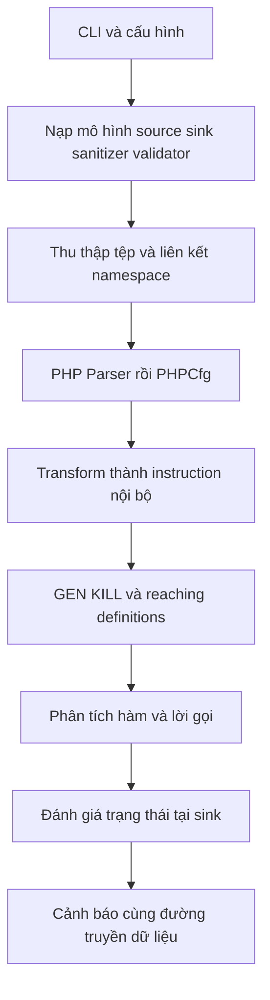
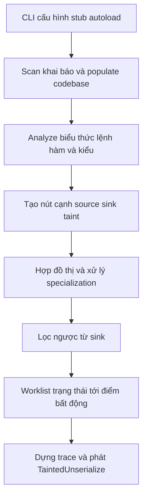
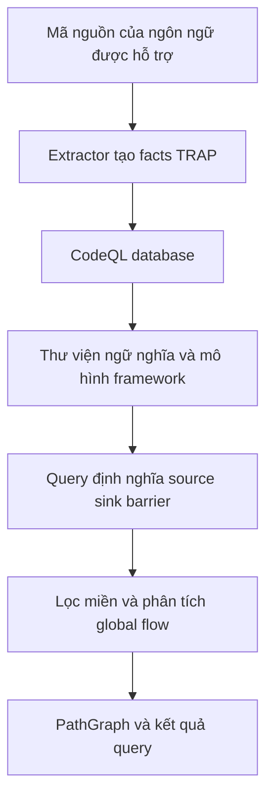
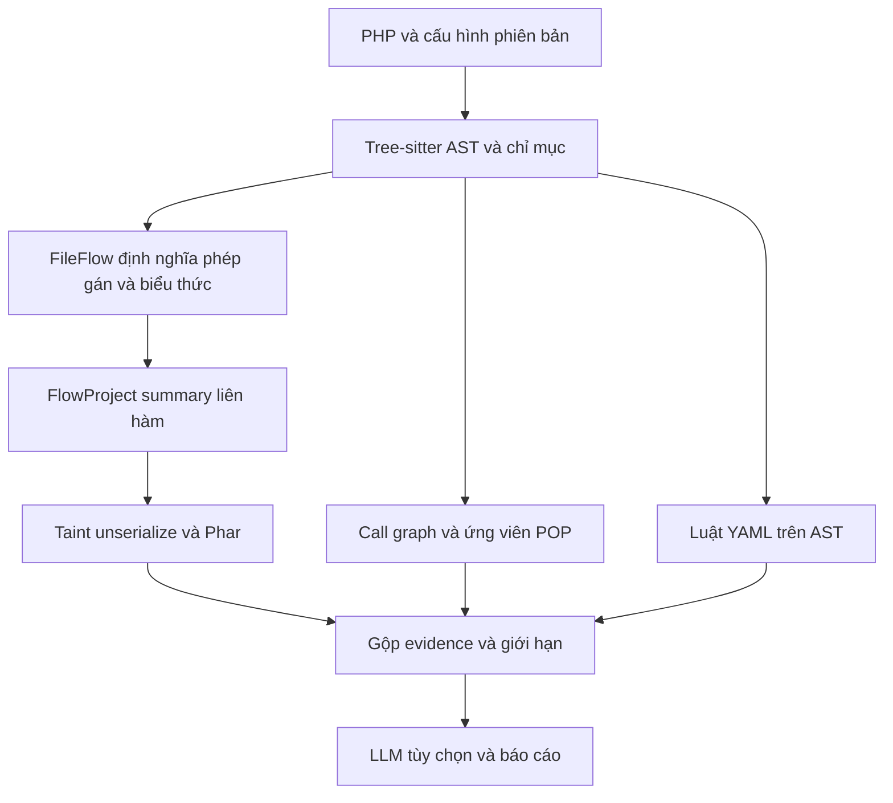
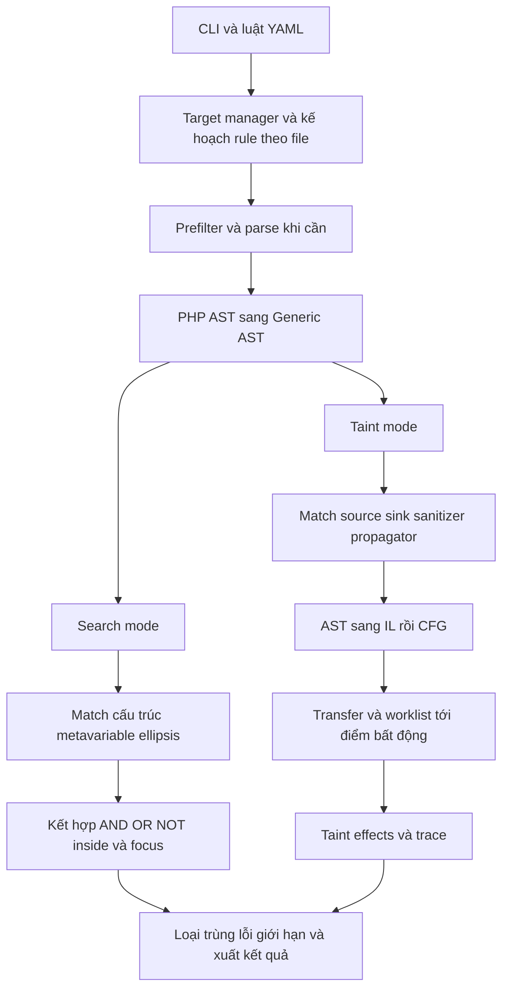
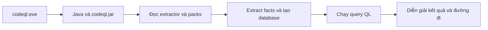

# Phân tích Progpilot, Psalm, CodeQL, Semgrep và đối chiếu PHP Deserialization SAST

Ngày khảo sát: 17/10/2026. Thứ tự phân tích: Progpilot → Psalm → CodeQL → công cụ hiện tại.

**Cập nhật sau khi tải lại công cụ:** mục 9 phân tích chi tiết Semgrep CE; mục 10 kiểm tra bản phân phối CodeQL mới; mục 11 so sánh cả năm công cụ và đề xuất áp dụng. Mục 4 ghi phân tích mã nguồn CodeQL đã đọc ở lần trước: thư mục `codeql/` hiện được thay bằng bản binary, nên các đường dẫn `shared/dataflow` và `python/ql` trong mục đó là tham chiếu lịch sử theo commit, không còn là tệp có sẵn tại vị trí cũ. Các mục Progpilot, Psalm và worklist của công cụ hiện tại đã được đối chiếu lại trong lần cập nhật này.

## 1. Phạm vi và cách đọc

Báo cáo đọc trực tiếp các đường xử lý chính: nhận cấu hình, phân tích cú pháp, biểu diễn chương trình, truyền dữ liệu liên hàm, nhận diện source/sink và sinh cảnh báo. Đây là khảo sát kiến trúc và các thuật toán trọng tâm, không phải chứng nhận đã kiểm tra từng dòng của mọi thư viện, extractor và bộ kiểm thử.

| Mã nguồn | Commit khảo sát |
|---|---|
| `progpilot/` | `38cb1e037ab487dead8677303fa65dd33e480772` |
| `psalm/` | `592d2061af6fcaded36b87b1c956c8e1eb8194fb` |
| `codeql/` | `cf4d0e1e86600a863b481090dbf202abd1687c29` |

Ba checkout tham chiếu không có thay đổi được `git status --short` báo tại thời điểm kiểm tra. Công cụ của người dùng là mã đang nằm trong `php_deserial_sast/`, bao gồm các sửa đổi gần đây về guard và đường dẫn. Các số dòng dưới đây là mốc tra cứu của bản hiện tại. Đường dẫn tính từ gốc workspace.

**Phân biệt thuật ngữ:** AST là cây cú pháp; CFG biểu diễn khả năng chuyển điều khiển giữa các khối lệnh; call graph biểu diễn quan hệ gọi; dataflow biểu diễn quan hệ truyền giá trị; taint theo dõi ảnh hưởng của dữ liệu không tin cậy. Có call graph không đồng nghĩa đã có CFG hay một bộ phân tích taint chính xác.

## 2. Progpilot

### 2.1. Cấu trúc và trách nhiệm

Gốc mã thực thi là `progpilot/package/src/progpilot/`.

| Thành phần | Vai trò được thể hiện trong mã |
|---|---|
| `Command/ProgpilotCommand.php`, `Analyzer.php` | Điểm vào, cấu hình, chọn tệp và điều phối phân tích. |
| `Context.php`, `ContextInternalApi.php` | Trạng thái dự án, tệp/hàm/khối hiện tại, bảng đối tượng, call stack và giới hạn. |
| `Transformations/Php/` | Chuyển biểu diễn PHPCfg thành instruction và đối tượng nội bộ. |
| `Code/MyCode.php`, `MyInstruction.php`, `Opcodes.php` | Biểu diễn chuỗi lệnh trung gian. |
| `Dataflow/VisitorDataflow.php`, `Definitions.php` | Lập định nghĩa biến, GEN/KILL, tính reaching definitions. |
| `Analysis/VisitorAnalysis.php`, `ResolveDefs.php`, `FuncAnalysis.php` | Duyệt lệnh, giải quyết giá trị và truyền trạng thái qua lời gọi. |
| `Analysis/TaintAnalysis.php`, `SecurityAnalysis.php` | Áp dụng source/sanitizer/validator/sink và tạo kết quả. |
| `Inputs/`, `uptodate_data/php/` | Mô hình cấu hình và dữ liệu luật PHP. |

### 2.2. Luồng xử lý



`Analyzer::__construct()` tạo parser PHP và parser PHPCfg; `transformPhp()` tại dòng 97 dùng traverser và visitor chuyển đổi. `computeDataFlowPhp()` lần lượt parse, transform và `visitDataFlow()`. Vì vậy Progpilot có lớp biểu diễn trung gian giữa cú pháp và phân tích bảo mật; không chỉ tìm tên hàm trong văn bản.

`Analyzer::run()` dòng 327 nạp cấu hình, mô hình framework và mô hình mặc định. `computeDataFlow()` kiểm tra kích thước tệp, tình trạng đã phân tích; `computeDataFlowOfNamespaces()` tìm tệp namespace phụ thuộc và phân tích khi cần. Việc liên kết này phụ thuộc thông tin namespace/lời gọi thu thập được, không nên hiểu là mô phỏng đầy đủ Composer autoload ở runtime.

`runAnalysisOfCurrentMyFile()` dòng 284 ưu tiên hàm không dùng global trước `{main}`, sau đó nhóm bị trì hoãn. Bình luận ngay trong mã thừa nhận thứ tự có thể ảnh hưởng initial return definitions và phân tích lời gọi. Đây là đặc điểm đáng chú ý khi so với một solver summary thuần theo điểm bất động.

### 2.3. Thuật toán reaching definitions

`VisitorDataflow` xử lý `ENTER_FUNCTION`, `ENTER_BLOCK`, `LEAVE_BLOCK`, `LEAVE_FUNCTION`. Tại dòng 156, nó tính KILL của khối; tại dòng 173, nó gọi `reachingDefs()` cho các khối của hàm.

`Definitions::reachingDefs()` dòng 288 lặp đến khi OUT không thay đổi:

```text
IN[B]  = hợp OUT[P], với P là khối tiền nhiệm của B
OUT[B] = GEN[B] hợp (IN[B] trừ KILL[B])
```

GEN chứa định nghĩa tạo trong khối; KILL chứa các định nghĩa cũ bị ghi đè. Trong triển khai này, `computeKill()` dựa vào `defEquality()`, phép so sánh tên định nghĩa. Không thể từ đó suy ra bộ phân tích có alias/heap chính xác; việc xử lý thuộc tính và trạng thái còn nằm ở các lớp giải quyết định nghĩa.

Ví dụ `$x = $_GET['x']; $x = 'fixed'; unserialize($x);` đòi hỏi loại định nghĩa tainted đã bị ghi đè. Với hai nhánh gán khác nhau, IN tại điểm hợp nhánh có thể chứa nhiều định nghĩa. CFG giúp mô tả đường điều khiển, nhưng hợp các khả năng vẫn có thể giữ đường không khả thi nếu không giải được điều kiện nhánh.

Solver trong tệp này duyệt các khối bằng vòng lặp đến ổn định; không phải worklist chỉ đánh thức những khối bị ảnh hưởng. Trên đồ thị lớn, số khối, số định nghĩa và số vòng lặp đều ảnh hưởng chi phí.

### 2.4. Phân tích liên hàm và trạng thái taint

`FuncAnalysis::funccallBefore()` dòng 93 liên kết đối số với tham số, gán state của đối số vào block của tham số. `VisitorAnalysis` dòng 159 kiểm tra hàm đích và call stack; dòng 184 truyền tham số, dòng 199 đi vào thân hàm.

Trước khi tái phân tích, visitor có thể dọn trạng thái taint và op information của hàm. Điều kiện tái phân tích xét đối số mới, hàm chưa thăm, phương thức instance, global và `{main}`. Nhánh khác phục hồi thuộc tính từ initial return definitions. Hàm đang có trong call stack không được đi vào theo cùng nhánh này. Cơ chế tránh đệ quy và tái sử dụng trạng thái giúp giới hạn chi phí, nhưng không phải bằng chứng rằng mọi chu trình đệ quy đều được giải đầy đủ.

`funccallAfter()` dòng 18 xử lý theo chuỗi: đối tượng trả về → validator → sanitizer → source → giá trị trả về chưa giải quyết → kiểm tra sink → nối return definitions. Phân biệt này quan trọng: một hàm trả dữ liệu đã làm sạch và một hàm trả boolean xác nhận dữ liệu là hai mô hình khác nhau.

`TaintAnalysis::funccallValidator()` dòng 20 xử lý cấu hình như `valid`, `not_tainted`, `array_not_tainted`, `equals`, `notequals`, cùng giá trị boolean cần có. Thông tin được lưu thành `condition_defs` và `valid_when_returning`. `funccallSanitizer()` dòng 151 và `funccallSource()` dòng 284 là hai điểm mở rộng khác.

`SecurityAnalysis::isSafeStateCondition()` dòng 119 xét taint, kiểu cast, tình trạng toàn bộ thuộc tính/mảng bị taint và loại sanitizer. Sanitizer phải phù hợp loại attack của sink hoặc loại ALL; vì vậy làm sạch phục vụ một ngữ cảnh không mặc nhiên làm sạch cho mọi sink.

### 2.5. Insecure deserialization và giới hạn

Trong `uptodate_data/php/sinks.json` dòng 186, `unserialize` được mô hình hóa với tham số thứ nhất, `attack=code_injection`, `cwe=CWE_95`. Entry này không biểu diễn `allowed_classes` của đối số thứ hai. Khi đối chiếu POI cần lọc theo sink và đọc mã, không chỉ lọc nhãn CWE-502.

Điểm mạnh có căn cứ là CFG, reaching definitions, mô hình bảo mật tách khỏi visitor và truyền trạng thái liên hàm. Các điểm cần thận trọng là xấp xỉ global/đệ quy, liên kết động, chất lượng mô hình framework và giới hạn tài nguyên. `VisitorAnalysis` kiểm tra thời gian và bộ nhớ ở các dòng 459–469. Hết thời gian hoặc exception không thể diễn giải là không có lỗ hổng.

## 3. Psalm

### 3.1. Kiến trúc: phân tích kiểu làm nền cho phân tích taint

Gốc mã là `psalm/src/Psalm/`. Psalm tổ chức phân tích PHP rộng hơn một danh sách source/sink: kiểu, cấu trúc lớp, chữ ký hàm, ngữ cảnh lệnh và quan hệ dữ liệu cùng tham gia tạo đồ thị.

| Thành phần | Vai trò |
|---|---|
| `Internal/Cli/Psalm.php` | Tùy chọn CLI, bật taint analysis và cấu hình chạy. |
| `Internal/Analyzer/ProjectAnalyzer.php` | Nạp stub/autoload, lập kế hoạch scan và analyze. |
| `Internal/Codebase/`, `Storage/`, `Internal/Provider/` | Thông tin chương trình, bộ lưu trữ lớp/hàm, cache và tổ chức tác vụ. |
| `Internal/Analyzer/Statements/Expression/` | Phân tích phép gán, lời gọi, truy cập mảng/thuộc tính và kiểu biểu thức. |
| `Internal/DataFlow/DataFlowNode.php`, `Path.php` | Nút và cạnh truyền dữ liệu. |
| `Internal/Codebase/TaintFlowGraph.php` | Tích lũy đồ thị source/sink/edge, nối thông tin giữa đơn vị phân tích. |
| `Internal/Codebase/TaintFlowResolution.php` | Giải đồ thị, quản lý ngữ cảnh và dựng trace. |
| `dictionaries/InternalTaintSinkMap.php`, `Type/TaintKind.php` | Mô hình sink builtin và loại taint. |

### 3.2. Luồng xử lý



`ProjectAnalyzer::check()` dòng 442 phân biệt scan với analyze. Ở nhánh phân tích đầy đủ, nó nạp stub/autoload, thêm tệp shallow/deep scan, khởi tạo plugin và gọi `scanFiles()` dòng 486. Sau khi codebase được populate, `analyzeFiles()` dòng 529 đi vào phân tích. Nhánh diff sử dụng tệp thay đổi và tệp liên quan; không nên đánh đồng mọi lần chạy Psalm với quét lại toàn bộ từ đầu.

Trong `ArgumentAnalyzer.php` khoảng dòng 1820 trở đi, phân tích lời gọi lấy đồ thị hiện tại, tính taint được loại theo kiểu và áp dụng sự kiện plugin thêm/bớt taint. Nút tham số được định danh theo tham số khai báo. Đối số đặt tên vì thế cần quy về đúng vị trí khai báo, thay vì dùng thứ tự xuất hiện trong lời gọi.

Mã còn tách virtual dispatch node khỏi parameter node để lời gọi kế thừa không vô tình truyền sang mọi override. Đây là ví dụ cụ thể cho thấy độ chính xác không chỉ nằm ở danh sách sink: cách định danh và nối cạnh có thể tạo hoặc loại false positive liên hàm.

### 3.3. Cơ chế giải taint trong checkout này

`TaintFlowGraph::connectSinksAndSources()` dòng 708 sắp thứ tự đồ thị, xử lý specialization của lời gọi không thuần, liên kết generator nếu có và khởi tạo `TaintFlowResolution` dòng 739.

`TaintFlowResolution::prepareGraph()` dòng 736 dựng cạnh ngược từ sink, kể cả liên kết specialized/unspecialized, rồi loại vùng không thể tới sink trong đồ thị đã xây. Đây là giảm miền tính toán trước khi truyền taint, không phải bỏ tệp đơn thuần vì không chứa chuỗi `unserialize`.

Một trạng thái gồm nút hiện tại, ngữ cảnh entry của lời gọi chuyên biệt và thông tin phép gán đang mở. Tập taint không tạo thêm danh tính trạng thái: các taint tới cùng trạng thái được hợp bằng bit vector. `resolve()` dòng 687 chỉ lên lịch lại trạng thái khi có thông tin mới; hàng đợi chạy đến điểm bất động.

Trong một thân hàm, hiệu ứng truyền taint được biểu diễn theo hai tập `kept` và `added`:

```text
taint_kết_quả = (taint_đầu_vào AND kept) OR added
```

Nhờ đó thân hàm có thể dùng chung cho nhiều lần gọi có tập taint khác nhau. Tại `walkEdges()` dòng 1978, taint được thêm/bớt theo cạnh. Không nên mô tả triển khai hiện tại là DFS thử mọi đường đi hoặc chạy lại toàn bộ thân hàm cho từng nguồn.

Thông tin open assignments dùng để đối chiếu gán/đọc các phần của biểu thức như khóa mảng và thuộc tính. Các hàm `getNextOpenAssignments()`, `composeOpenAssignments()`, `widenOpenAssignments()` và `truncateOpenAssignments()` cho thấy có mô hình chi tiết hơn một nhãn taint cho cả biến, đồng thời có xấp xỉ để trạng thái hữu hạn. Phần comment của solver nêu giới hạn độ sâu và tăng đơn điệu của tập taint để giải thích hội tụ.

Trạng thái còn lưu predecessor để dựng trace khi báo lỗi. Khả năng dựng đường giải thích không đồng nghĩa đường đó đã được chứng minh thực thi được với toàn bộ ràng buộc runtime.

### 3.4. Phát hiện deserialization

`dictionaries/InternalTaintSinkMap.php` dòng 57 ánh xạ `unserialize` sang `TaintKind::INPUT_UNSERIALIZE`; dòng 31 có `igbinary_unserialize`. `TaintKind.php` dùng bit cho loại này. `TaintFlowGraph.php` dòng 986 chuyển loại taint thành issue `TaintedUnserialize`.

Điều kiện báo cáo là taint thuộc loại liên quan đến sink truyền tới sink qua đồ thị và không bị mô hình loại bỏ. Bản đồ builtin trên chỉ thể hiện loại sink; bản thân entry không chứng minh có kiểm tra đầy đủ `allowed_classes`. Muốn kết luận chính xác về một cấu hình phải kiểm tra cả analyzer, plugin và test tương ứng.

Psalm có nền tảng tốt cho kiểu, named arguments, kế thừa và ngữ cảnh truyền dữ liệu. Tuy nhiên, kết quả phụ thuộc stub, autoload, dependency và mô hình nguồn. Một thư viện có API deserialize nguy hiểm nhưng không có nguồn request trong phạm vi phân tích có thể không tạo `TaintedUnserialize`. Điều này khác với mục tiêu liệt kê API rủi ro hoặc tìm gadget.

## 4. CodeQL

### 4.1. Phạm vi có thể phân tích và giới hạn PHP

Checkout chứa extractor, thư viện QL, query và test của nhiều ngôn ngữ. Không thể coi việc đọc repository này là đã đọc toàn bộ triển khai bộ thực thi CodeQL CLI/evaluator. Phần dưới phân tích cơ chế thể hiện trong extractor và thư viện dataflow công khai.

Tại ngày khảo sát, PHP không nằm trong [danh sách ngôn ngữ được CodeQL hỗ trợ chính thức](https://codeql.github.com/docs/codeql-overview/supported-languages-and-frameworks/). Vì vậy CodeQL được dùng để đối chiếu kiến trúc; kết quả benchmark PHP phải ghi **N/A**, không phải 0 finding. Query Python dưới đây là ví dụ về thiết kế, không phải luật PHP có thể chép vào rồi chạy ngay.

### 4.2. Cấu trúc và flow

| Thành phần | Đường dẫn tiêu biểu |
|---|---|
| Extractor ngôn ngữ | `codeql/python/extractor/semmle/extractors/py_extractor.py` |
| Xuất thông tin chương trình | `codeql/python/extractor/semmle/python/extractor.py` |
| Giao diện dataflow dùng chung | `codeql/shared/dataflow/codeql/dataflow/DataFlow.qll` |
| Cơ chế taint dùng chung | `codeql/shared/dataflow/codeql/dataflow/TaintTracking.qll` |
| Lọc ban đầu và giải luồng | `.../internal/DataFlowImplStage1.qll`, `DataFlowImpl.qll` |
| Mô hình summary | `.../internal/FlowSummaryImpl.qll` |
| Query deserialization minh họa | `codeql/python/ql/src/Security/CWE-502/UnsafeDeserialization.ql` |



Ở ví dụ Python, `PythonExtractor::_get_module_and_imports()` tìm module và phụ thuộc import; `process()` chuyển module cho extractor. `extractor.py` nhập `ASTPass`, `FlowPass`, có `process_source_module()` dòng 95 và ghi TRAP dòng 122. Facts được cung cấp cho pipeline tạo database; sau đó query làm việc trên biểu diễn chương trình, không quét lại văn bản bằng regex cho mỗi luật.

### 4.3. Tách mô hình ngôn ngữ khỏi cấu hình lỗ hổng

`DataFlow.qll` có `InputSig` mô tả nút ngôn ngữ, gồm các vai trò như tham số, đối số và return. `ConfigSig` dòng 401 cho người viết query định nghĩa `isSource`, `isSink`, `isBarrier`, barrier vào/ra và bước flow bổ sung. `StateConfigSig` cho phép trạng thái bổ sung đi cùng flow.

`DataFlowMake::Global` dòng 1122 kết hợp cấu hình với `ImplStage1`, sau đó chuyển sang `Impl`. `DataFlowImplStage1.qll` ghi rõ mục đích lọc nhanh reachability liên thủ tục; mã có các quan hệ flow xuôi/ngược và cạnh đối số–tham số, return. Điều này tránh dùng ngay mức phân tích chi tiết nhất cho toàn bộ đồ thị.

`TaintTracking.qll::AddTaintDefaults` hợp barrier của query với `defaultTaintSanitizer`, hợp cạnh query với `defaultAdditionalTaintStep`, và điều khiển implicit reads. Vì vậy taint flow có thể truyền qua thao tác biến đổi giá trị mà value-preserving dataflow thông thường không coi là cùng giá trị.

Giới hạn vẫn tồn tại: `DataFlow.qll` khai báo `accessPathLimit()` mặc định 5 ở lớp giao diện ngôn ngữ, và cho cấu hình ghi đè qua `ConfigSig`; có `fieldFlowBranchLimit()`. Không nên kết luận mọi query dùng cùng một mức chính xác hay cùng chi phí, hoặc CodeQL phân tích đầy đủ heap không giới hạn.

### 4.4. Theo dấu một query deserialization

`UnsafeDeserialization.ql` khai báo `@kind path-problem`, nhập `UnsafeDeserializationQuery` và `UnsafeDeserializationFlow::PathGraph`, sau đó chọn cặp nút thỏa `flowPath(source, sink)`.

Trong `python/ql/lib/semmle/python/security/dataflow/UnsafeDeserializationQuery.qll`, module cấu hình quy nguồn về lớp `Source`, đích về `Sink`, barrier về `Sanitizer`; cuối cùng khởi tạo `TaintTracking::Global<UnsafeDeserializationConfig>`.

`UnsafeDeserializationCustomizations.qll` cung cấp nguồn theo threat model đang bật, sink từ `Decoding.mayExecuteInput()`, sink/barrier từ models-as-data và guard so sánh hằng. Quy trình vì thế là: API/framework cụ thể → khái niệm ngữ nghĩa → source/sink/barrier → global flow → đường giải thích.

Điểm đáng học là tách engine khỏi mô hình lỗ hổng và mô hình framework. Muốn đưa PHP vào cùng kiến trúc cần extractor/schema và thư viện ngữ nghĩa PHP phù hợp; chỉ viết query gọi tên `unserialize` là chưa đủ.

## 5. Công cụ PHP Deserialization SAST hiện tại

### 5.1. Cấu trúc và luồng dữ liệu

`scanner.py::scan()` dòng 57 điều phối Tree-sitter, bảng ký hiệu, dataflow, call graph, luật, POP, gộp finding và reporter. Sơ đồ tổng quan đã có trong [báo cáo cấu trúc ngắn](BAO_CAO_CAU_TRUC_FLOW.md).



`core/dataflow.py::FileFlow` lập chỉ mục theo scope, giải truy cập trường, đọc định nghĩa tại vị trí sử dụng và đánh giá biểu thức. Các điểm trọng tâm: `_contexts()` dòng 220, `compatible()` dòng 234, `dominates()` dòng 238, `read()` dòng 248, `evaluate()` dòng 343, `bind()` dòng 484. Tên `dominates` ở đây không đồng nghĩa công cụ đã xây dựng dominator tree đầy đủ trên CFG.

`FlowProject::build()` dòng 935 lập quan hệ callee → callers, đặt các hàm vào queue, tính summary return/sink và chỉ lên lịch lại caller khi summary thay đổi. Mã xóa cache trước khi tính lại, so sánh khóa flow/sink và lưu `converged = not queue`. Budget là `max(10000, số_hàm * max_rounds)`; không phải giới hạn cứng độ dài chuỗi gọi ở 64 hàm.

Call graph phục vụ POP là nhánh khác với cơ chế resolve của taint. `call_graph.py` giới hạn một số nhóm dispatch ở 4 và 12 ứng viên, cộng số bỏ qua vào `dispatch_candidates_truncated`. Có tìm ngược từ sink để giảm duyệt POP, nhưng thiếu cạnh do giới hạn vẫn làm coverage không đầy đủ.

### 5.2. Những xử lý chuyên biệt đã có

- `unserialize_safe()` dòng 521 đánh giá tùy chọn tái tạo object. `allowed_classes=false` ngăn tái tạo object tại lời gọi đó; không phải chứng minh mọi rủi ro deserialization đều biến mất.
- `fixed_prefix()`, `phar_path_may_resolve_to_wrapper()` và `configured_local_prefix()` xét đường dẫn cho Phar. Phải giữ phân biệt hằng được chứng minh với mặc định cấu hình có thể bị runtime ghi đè.
- `taint_engine.py` tách `source_to_sink`, nguồn framework mô hình hóa, API giả định, `guarded_flow_review`, `unresolved_return_flow` và `configured_local_path_review`.
- Guard bất kỳ không còn tự động hạ mức cảnh báo. `isset`, kiểm tra chuỗi và `is_serialized` không tự chứng minh dữ liệu không do attacker kiểm soát; kiểm tra MAC cần xác minh thêm tính toàn vẹn và nguồn khóa.
- Library mode giúp rà API công khai khi không có caller ứng dụng; POP giúp tìm ứng viên gadget. Hai nhóm này không chứng minh có luồng HTTP khai thác được.

### 5.3. Khoảng cách còn lại

Công cụ chưa có nền CFG/SSA tổng quát và hệ thống kiểu/ngữ cảnh như những thành phần đã khảo sát ở Progpilot/Psalm. Định nghĩa theo vị trí và ngữ cảnh AST giải được nhiều ca nhỏ nhưng khó khái quát đầy đủ loop, exception, alias, reference, heap và mutation liên hàm. Summary hội tụ chỉ chứng minh ổn định trong mô hình hiện có, không chứng minh mô hình bao phủ chương trình thực.

Nguồn qua database/cache/session, callback của framework, lời gọi động và cấu hình runtime cần mô hình riêng. Giới hạn POP, lỗi parse và unresolved flow phải đi cùng kết luận; hoàn tất quét mọi tệp không có nghĩa đã phân tích mọi đường đi. LLM tùy chọn hỗ trợ xem xét, không thay thế thiếu sót của đồ thị dữ liệu.

## 6. So sánh trực tiếp

### 6.1. Ma trận kiến trúc

| Tiêu chí | Progpilot | Psalm | CodeQL | Công cụ hiện tại |
|---|---|---|---|---|
| Mục tiêu | SAST bảo mật PHP nhiều loại lỗi | Phân tích PHP/kiểu và taint | Nền tảng query bảo mật nhiều ngôn ngữ | Chuyên PHP insecure deserialization |
| PHP chính thức | Có | Có | Không trong danh sách khảo sát | Có qua Tree-sitter |
| Biểu diễn chính | PHPCfg, instruction, definitions/state | Kiểu/codebase và đồ thị dataflow/taint | Facts/database và quan hệ QL | AST index, flow và summary riêng |
| Phân tích liên hàm | Binding tham số, duyệt hàm, tái sử dụng return state | Đồ thị có specialization và solver trạng thái | Global flow với mô hình call/return | Summary return/sink và worklist phụ thuộc |
| Giảm tính toán | Trạng thái đã thăm, điều kiện tái phân tích, giới hạn | Lọc sink reachability, bit vector, chia sẻ body walk | Stage1 pruning, mô hình summary, giới hạn access path | Cache, AST index, worklist, lọc POP |
| Điều kiện bảo vệ | Validator và sanitizer theo attack | Kiểu, mô hình cạnh thêm/bớt taint, plugin | Barrier/guard và mô hình query | Một số predicate/đường dẫn, evidence để rà soát |
| API không có caller | Phụ thuộc source model | Phụ thuộc source/threat model | Phụ thuộc query/threat model | Library mode ghi rõ giả định |
| POP chain | Không phải pipeline chuyên POP khảo sát ở đây | Taint không tương đương tìm chuỗi POP | Cần query và mô hình thích hợp | Có ứng viên chuỗi, chịu giới hạn dispatch |
| Độ chính xác | Phụ thuộc mô hình và xấp xỉ | Phụ thuộc kiểu, dependency và mô hình | Phụ thuộc extractor, query và mô hình | Phụ thuộc scope/flow đơn giản hơn và luật chuyên biệt |

Không có cơ sở để xếp hạng độ chính xác tổng quát chỉ từ độ phức tạp kiến trúc. Tuy nhiên, mã nguồn cho thấy Psalm có nhiều cơ chế mô hình hóa PHP hơn công cụ hiện tại; CodeQL có sự tách biệt engine–query–model rõ; Progpilot là tham chiếu trực tiếp cho CFG/reaching definitions.

### 6.2. Những trường hợp cần diễn giải khác nhau

| Trường hợp | Điều cần đánh giá |
|---|---|
| `unserialize($_GET['x'])` | Luồng nguồn tới sink trực tiếp; còn cần lớp/gadget và ngữ cảnh để kết luận tác động. |
| `unserialize($x, ['allowed_classes' => false])` | Generic deserialization sink khác POI do tái tạo object; phải thống nhất taxonomy khi tính false positive. |
| Public API `decode($x)` không có caller | Không có taint request không đồng nghĩa API an toàn; library-mode finding cũng chưa chứng minh attacker gọi được. |
| Chỉ có lớp với `__destruct()` nguy hiểm | Ứng viên gadget khác một đầu vào deserialize reachable. |
| `is_serialized($x)` rồi deserialize | Kiểm tra định dạng khác xác thực nguồn hoặc tính toàn vẹn. |
| Filesystem nhận đường dẫn do request điều khiển | Cần xét PHP mục tiêu, khả năng dùng wrapper và guard; không mặc nhiên là POI. |
| Sink bị bảo vệ bằng kiểm tra chữ ký | Cần chứng minh cùng payload được kiểm tra, nhánh thất bại kết thúc và khóa không bị attacker kiểm soát. |

### 6.3. Đối chiếu bằng các lượt chạy đã lưu

Đây là sử dụng lại artifact, **không có benchmark mới trong lần phân tích này**. Các bộ kết quả không cùng snapshot: `external-final`/`external-retry` là công cụ tham chiếu; `deep-current` là lần quét rộng; `fixes-validated` là lần kiểm tra sau sửa trên ba dự án. Không ghép chúng thành bảng xếp hạng precision/recall hiện tại.

| Dự án | Progpilot/Psalm trong đợt tham chiếu | Ý nghĩa đối với công cụ hiện tại |
|---|---|---|
| XVWA | Progpilot có 1 sink trước khi exception; Psalm có 1 `TaintedUnserialize` | Bản `fixes-validated` nhận source → `unserialize` ở `home.php:38` là CRITICAL/HIGH, không hạ vì `isset`. |
| Saloon | Cả hai có 0 cảnh báo unserialize theo tiêu chí đợt đối chiếu | Luật/API exposure của công cụ có thể chỉ ra deserialize cho phép object khi thiếu caller request; khác phạm vi nguồn. |
| Monolog | Psalm 0; Progpilot bản mới 0, bản 1.23.0 timeout | Không có taint request không phủ định sự hiện diện của ứng viên gadget trong thư viện. |
| TCPDF | Progpilot timeout ở lượt chạy lại; Psalm timeout | Sau sửa guard, taint finding của công cụ giảm 3 → 0; 37 tổng finding gồm 36 cú pháp và 1 POP, không phải 37 POI. |
| WordPress | Progpilot timeout; Psalm 0 và có diagnostic | Hai vị trí unserialize của công cụ vẫn cần xem guard. 70 taint finding của lần mới gồm nhiều trạng thái cần rà soát, không phải 70 lỗ hổng xác nhận. |
| Drupal | Progpilot timeout; Psalm lỗi dependency, không có JSON hợp lệ | Không dùng các lượt thất bại làm số âm để tính recall hoặc chứng minh công cụ tốt hơn. |

Đợt 64 ca nhỏ đã lưu có 64/64 ca theo oracle của bộ test ở snapshot đó; Progpilot báo trên 31 ca, Psalm trên 43 ca. Đây là **số ca có báo cáo**, không tự động là số true positive. Bộ test do dự án xây dựng, taxonomy khác nhau và cách đóng gói phân tích khác nhau, nên không thể viết “độ chính xác 100% trên dự án thực tế”. Bộ hồi quy sau sửa guard cũng không thay thế việc chạy lại toàn bộ phép so sánh trên cùng snapshot.

Nguồn kiểm chứng tại workspace:

- [Kết quả tham chiếu và điều kiện chạy](KET_QUA_DOI_CHIEU.md).
- [Đánh giá các ca nhỏ](KIEM_THU_NHO_MO_RONG.md).
- [Sửa guard và đường dẫn](SUA_LOI_GUARD_DUONG_DAN.md).
- `reports/evaluation/external-final/`, `reports/evaluation/external-retry/`.
- `reports/evaluation/small-expanded/`, `reports/evaluation/fixes-validated/comparison.json`.

## 7. Hướng cải thiện rút ra từ mã nguồn

Đây là đề xuất thiết kế; không phải các thay đổi đã được triển khai trong lần khảo sát này.

| Ưu tiên | Công việc | Cơ sở tham khảo | Tiêu chí kiểm chứng |
|---|---|---|---|
| 1 | Chuẩn hóa evidence: source quan sát được, nguồn giả định, sink cú pháp, guard, gadget và coverage | Cấu hình threat model và phân tầng kết quả | Không cộng API/POP/rule match thành số lỗ hổng xác nhận. |
| 2 | Bổ sung CFG từng hàm và transfer function cho gán/nhánh/return/loop/exception | Progpilot Definitions/VisitorDataflow | Ghi đè, hợp nhánh, early return, loop và exception có oracle độc lập. |
| 3 | Chuẩn hóa định danh tham số/return/field và mô hình side effect | Psalm ArgumentAnalyzer/DataFlowNode | Named args, alias, mutation, kế thừa và hai lời gọi riêng không nhiễm lẫn. |
| 4 | Tách source/sink/propagator/guard/version model khỏi logic duyệt AST | Progpilot Inputs, CodeQL ConfigSig/models | Mỗi mô hình mới có ca dương và ca âm, xét đúng vị trí đối số và điều kiện. |
| 5 | Pruning dataflow từ sink và summary cache có invalidation theo phụ thuộc | Psalm prepareGraph, CodeQL Stage1 | So với chế độ không pruning trên corpus nhỏ cho cùng kết quả; đo thời gian theo phase. |
| 6 | Mở rộng solver trạng thái hữu hạn và đặc tả cách widening | Psalm TaintFlowResolution | Đệ quy hội tụ; mọi cắt giảm được ghi nhận, không im lặng coi là an toàn. |
| 7 | Làm rõ callback/framework, storage và ranh giới ứng dụng/thư viện | Cả ba cách tổ chức mô hình | Corpus riêng cho HTTP → cache/database → deserialize, có và không có kiểm tra toàn vẹn. |

Không nên viết lại toàn bộ engine chỉ để mô phỏng CodeQL. Lộ trình hợp lý là giữ parser, reporter và các quy tắc deserialization đã kiểm chứng; cải thiện dần biểu diễn control/dataflow, đo tác động bằng ca hồi quy và một corpus thực tế được gán nhãn độc lập.

## 8. Kết luận

**Progpilot** cung cấp ví dụ trực tiếp về CFG, GEN/KILL, reaching definitions và mô hình bảo mật theo ngữ cảnh attack. **Psalm** là tham chiếu sâu cho ngữ nghĩa PHP, định danh các nút liên hàm, truyền taint theo trạng thái và giảm tính toán bằng tái sử dụng. **CodeQL** nổi bật ở sự tách biệt giữa extractor, cơ sở dữ liệu chương trình, engine dataflow và query, nhưng không phải công cụ đối chứng PHP trực tiếp trong phạm vi hiện tại.

**PHP Deserialization SAST** có giá trị ở các xử lý chuyên biệt như `allowed_classes`, Phar, library mode và ứng viên POP, cùng khả năng xuất evidence/giới hạn. Khoảng cách cốt lõi nằm ở độ đầy đủ của mô hình chương trình: CFG, alias/heap, kiểu, side effect, dynamic dispatch và framework. Thêm tên sink hoặc tăng severity không giải quyết được khoảng cách này. Đánh giá đúng cần tách khả năng nhận diện điểm nguy hiểm khỏi bằng chứng luồng dữ liệu và khỏi xác nhận khai thác thực tế.

## 9. Semgrep: phân tích mã nguồn Community Edition vừa kiểm tra

### 9.1. Phiên bản khảo sát và cấu trúc

Checkout `semgrep/` ở commit `51602ad27f09ef9342a5620601de5ef8f572fbc6`, không có thay đổi được `git status --short` báo. Đây là mã nguồn Community Edition (CE). Báo cáo đọc đường thực thi CE; sự hiện diện của hook hoặc kiểu dữ liệu dùng chung không chứng minh đã có engine liên tệp đầy đủ trong checkout này. Không có bước build Semgrep hoặc benchmark Semgrep mới trong đợt khảo sát.

| Lớp | Tệp/thư mục và điểm vào | Trách nhiệm |
|---|---|---|
| CLI Python | `cli/src/semgrep/run_scan.py:1276` | Điều phối cấu hình, mục tiêu và việc chạy phân tích. |
| Chọn tệp | `cli/src/semgrep/target_manager.py:851`, `get_files_for_rule():1324` | Lọc tệp theo luật, ngôn ngữ, ignore và giới hạn. |
| Gọi engine | `cli/src/semgrep/core_runner.py:1352` | Lập kế hoạch, truyền luật/mục tiêu, chạy core và đọc kết quả. |
| Parser PHP | `src/parsing/Parse_target.ml:124`, `languages/php/` | Chọn parser PHP, chuyển AST PHP sang Generic AST. |
| Matching | `src/matching/Matching_generic.ml`, `src/engine/Match_search_mode.ml` | So mẫu cấu trúc và kết hợp các điều kiện trong luật. |
| IR/CFG | `src/analyzing/AST_to_IL.ml`, `CFG_build.ml`, `src/il/` | Hạ biểu thức và lệnh thành IL, dựng control-flow graph. |
| Taint mode | `src/engine/OSS_match_tainting_mode.ml:277` | Lập cấu hình taint và phân tích hàm/top-level. |
| Solver | `src/tainting/OSS_dataflow_tainting.ml`, `src/analyzing/Dataflow_core.ml` | Transfer function và điểm bất động trên CFG. |
| Trạng thái | `src/tainting/OSS_taint_lval_env.*`, `OSS_taint_shape.*`, `Taint.*` | Lưu taint theo l-value, shape và trace. |
| Prefilter | `src/prefiltering/Analyze_rule.ml`, `Analyze_pattern.ml` | Suy điều kiện cần để giảm số cặp rule–file phải phân tích. |

CLI chính vẫn là Python; các chức năng được chuyển dần sang OCaml/RPC. Không lấy sự có mặt của `src/osemgrep` làm bằng chứng rằng entry point chính hiện tại là `osemgrep`.

### 9.2. Flow: hai chế độ dùng chung parser, khác cách kết luận



`Match_rules.ml` chia nhóm taint và non-taint, dispatch `Search` sang `Match_search_mode.check_rule`, taint sang `Match_tainting_mode.check_rules()`. Wrapper taint mặc định chọn `OSS_match_tainting_mode.check_rules` khi không có hook thay thế.

Điểm khác biệt quan trọng: search mode có thể báo `unserialize($X)` chỉ vì khớp AST. Taint mode yêu cầu dữ liệu mang nhãn từ source truyền tới sink theo mô hình. Hai chế độ đều hữu ích nhưng không được cộng thành cùng một loại bằng chứng lỗ hổng.

### 9.3. Parser PHP và Generic AST

Nhánh `Lang.Php` trong `Parse_target.ml` đăng ký parser PHP truyền thống và Tree-sitter, rồi áp dụng `Php_to_generic.program`. Đường chuyển đổi PHP nằm trong `languages/php/generic/php_to_generic.ml`; parser Tree-sitter ở `languages/php/tree-sitter/Parse_php_tree_sitter.ml`.

Generic AST giúp engine matching và taint dùng lại cho nhiều ngôn ngữ. Mẫu `$X`, `...`, lời gọi và phép gán được hiểu theo cấu trúc thay vì chuỗi nguyên văn. Đổi lại, mỗi bước chuyển AST ngôn ngữ sang biểu diễn chung phải giữ đủ ngữ nghĩa; AST chung không tự giải quyết được PHP references, dynamic dispatch hoặc autoload.

Công cụ của người dùng cũng dựa trên Tree-sitter, nhưng phân tích trực tiếp AST PHP bằng các lớp riêng. Vì vậy khác biệt trọng tâm là lớp mô hình phía sau parser, không phải chỉ thay parser là đạt mức phân tích của Semgrep.

### 9.4. Search mode: phép toán trên kết quả khớp

`Match_search_mode.ml` tách việc khớp một mẫu, duyệt cây và tổ hợp kết quả. Trong nhánh khoảng dòng 982–1093, `Inside`, `Or`, `And` và phép phủ định được xử lý theo range và bindings của metavariable. `apply_focus_on_ranges()` dòng 382 thu hẹp vị trí theo metavariable cần xét.

Một luật nhiều điều kiện không tương đương nhiều biểu thức regex độc lập: bindings của `$DATA` cần tương thích; `pattern-inside` giới hạn phạm vi; `pattern-not` loại tập kết quả theo ngữ nghĩa matching. Vì vậy một rule loader chỉ đọc được YAML chưa đủ để tuyên bố tương thích toàn bộ luật Semgrep.

Ví dụ `unserialize($DATA, ...)` có thể dùng để tìm điểm cần rà soát, nhưng chưa biết `$DATA` có đến từ request hay một hằng. `pattern-not` cho một literal options chỉ loại những dạng mà matcher nhận diện được; không thay thế đánh giá options qua biến, merge hoặc lời gọi trả options.

### 9.5. Taint mode: IL, CFG và solver

`OSS_match_tainting_mode.check_fundef()` dòng 277 thực hiện chuỗi rõ ràng:

```text
AST_to_IL.function_definition
→ CFG_build.cfg_of_fdef
→ OSS_taint_input_env.mk_fun_input_env
→ OSS_dataflow_tainting.fixpoint
→ effects + mapping
```

`check_rule()` dòng 289 parse lười AST, dùng `Match_taint_spec.taint_config_of_rule` tìm vùng source/sanitizer/sink, tạo môi trường file, rồi duyệt từng định nghĩa hàm. Lambda/arrow được xử lý cùng hàm bao quanh thay vì đi vào thêm lần nữa. Bộ điều phối còn xét lệnh khởi tạo đối tượng và top-level như các đơn vị CFG riêng.

`AST_to_IL.ml` mô tả cách hạ lời gọi thành lệnh chuẩn bị đối số, call và biến tạm; biểu thức điều kiện/AND/OR thành nhánh; các loại vòng lặp thành Loop; break/continue thành goto; try/catch/finally thành cấu trúc có đích throw. `CFG_build.ml` giữ exit node, nhãn, goto chưa giải quyết và đích exception. Đây là nền tảng có hệ thống hơn suy luận nhánh chỉ từ ancestor AST.

`Dataflow_core.ml::fixpoint_worker()` lưu IN/OUT trong mảng đánh chỉ số node. Nó lấy node từ workset, tính transfer; nếu trạng thái khác trước thì đưa các node kế tiếp vào workset. Khi workset rỗng thì trả `Ok`; khi đạt điều kiện giới hạn thời gian thì trả `Timeout` cùng mapping hiện có.

```text
IN[n] = hợp trạng thái từ các tiền nhiệm
OUT[n] = transfer(n, IN[n])
OUT thay đổi → xét lại các node phụ thuộc
```

`OSS_dataflow_tainting.ml::fixpoint_aux` gọi solver với `Lval_env.equal`, transfer và hướng forward; sau đó `record_timeout` ghi nhận giới hạn. Việc có CFG và hội tụ vẫn không chứng minh đường taint là đường khả thi: phần giới thiệu của engine mô tả đây là MAY analysis, tức tìm khả năng có lỗi.

### 9.6. Trường, side effect và lời gọi hàm

`OSS_taint_lval_env.mli` nêu rõ taint gắn với biến/l-value, không phải object identity trong bộ nhớ; không có alias analysis đầy đủ. Mã có shape và offset, nhưng không nên suy ra heap model tổng quát hay mọi khóa mảng đều được phân biệt chính xác.

Các mô hình source/sanitizer/propagator có thể tác động bằng side effect. `OSS_dataflow_tainting.ml` xử lý taint trong biểu thức, lệnh, return và môi trường. `Taint.mli` có nhãn, token trace và call trace; các kiểu này hỗ trợ trình bày provenance, không tự chứng minh CE có phân tích liên tệp đầy đủ.

Tại `check_tainted_call()` khoảng dòng 1340, fallback lấy taint các đối số làm taint lời gọi nếu cấu hình cho phép `propagate_through_functions`. Với method chưa có thông tin thích hợp, taint của đối tượng nhận cũng có thể được hợp vào kết quả. Tùy chọn `taint_assume_safe_functions` và `taint_only_propagate_through_assignments` thay đổi hành vi này.

Do đó, nếu `unserialize(transform($_GET['x']))` có cảnh báo, không được mặc nhiên kết luận Semgrep đã đi vào thân `transform` và chứng minh nội dung trả về. Cảnh báo có thể đến từ giả định truyền taint qua lời gọi. Ngược lại, sink nằm trong hàm khác không tự được nối với request chỉ nhờ fallback return-taint. Cần phân biệt hai bài toán này khi đối chiếu với summary của công cụ hiện tại.

### 9.7. Cơ chế giúp quét nhiều tệp và tệp lớn

1. **Lập kế hoạch theo rule–file:** TargetManager lọc theo ngôn ngữ/đường dẫn và có `max_target_bytes`. Quét nhanh có thể một phần do bỏ qua tệp, nên phải đọc thông tin skipped.
2. **Prefilter theo điều kiện cần:** `Analyze_rule.ml` rút required patterns. Nếu không hiểu một nhánh OR, nó giữ khả năng khớp thay vì bỏ nhánh đó. Comment `AND vs OR and filter_map` giải thích rõ tính bảo thủ này. Lọc sai OR có thể tạo false negative trước khi parser chạy.
3. **AST tải khi cần và cache formula:** `check_rule()` dùng `lazy_ast_and_errors`, `per_file_formula_cache` để giảm công việc lặp.
4. **Worklist theo thay đổi:** không tính lại toàn CFG ở mỗi bước nếu không có trạng thái mới.
5. **Chia việc và giới hạn:** `core_runner.py` có rule sharding, `jobs`, timeout và timeout threshold; kết quả core được parse và hợp lỗi. Có nhiều worker không giải quyết tự động chi phí của một tệp cực lớn.

Ứng dụng cho dự án hiện tại: prefilter phải dựa trên điều kiện cần được chứng minh, không bỏ tệp chỉ vì thiếu `unserialize` khi tệp đó chứa nguồn, wrapper hoặc hàm truyền dữ liệu phục vụ phân tích liên hàm.

### 9.8. Rà soát bộ luật Semgrep PHP đang có trong workspace

Tệp `semgrep_php_deserialization.yml` là bộ luật trong workspace, không được coi là toàn bộ luật chính thức của Semgrep. Nó gồm hai taint rule và hai review rule. Các vấn đề đọc được trực tiếp từ cấu hình:

| Điểm | Tác động có thể có | Hướng xử lý đề xuất |
|---|---|---|
| Phar sanitizer coi `$PATH` trong nhánh `if (preg_match($RE, $PATH))` là sạch với mọi `$RE` | Regex chỉ kiểm tra định dạng vẫn có thể cho wrapper đi qua; có nguy cơ bỏ sót | Chỉ công nhận predicate có ngữ nghĩa chặn wrapper, kiểm tra đúng biến và nhánh kết thúc. |
| `automatic_phar_metadata_requires: PHP < 8.0` chỉ nằm ở metadata | Metadata mô tả không tự vô hiệu hóa rule khi quét PHP 8.x | Runner chọn rule theo PHP mục tiêu hoặc lọc có giải thích. |
| Sink là toàn lời gọi, chưa focus `$DATA`/`$PATH` | Engine có thể coi taint ở đối số khác là đủ cho sink; ví dụ mode của `fopen` không phải path | Focus đúng đối số nguy hiểm, có test kiểm soát từng vị trí. |
| Loại `allowed_classes=false` bằng mẫu literal | Chưa thể hiện đầy đủ options qua biến/merge/allowlist | Thêm test cấu trúc, phân biệt rule match với đánh giá giá trị. |
| `$_FILES[...]` mô hình nguồn rộng | Tên tệp do client đưa và temporary path do server tạo có mức kiểm soát khác nhau | Mô hình theo trường và đường dữ liệu thực tế. |
| Mẫu sanitizer `intval(...)` chưa thể hiện việc phân biệt hàm builtin với tên bị shadow | Có thể sai nếu matcher/namespace resolution không nhận đúng hàm | Test hàm cùng tên trong namespace và lời gọi `\intval`. |

Đây là rủi ro suy ra từ mã và luật, chưa phải số false positive/false negative được đo mới. Đặc biệt, ví dụ regex chỉ chấp nhận chuỗi có ký tự chữ không loại trừ `phar://`; vì thế không được dùng mọi kiểm tra `preg_match` làm sanitizer bảo mật.

## 10. CodeQL mới tải: cấu trúc thực tế và kiểm tra khả năng chạy

### 10.1. Thư mục hiện tại khác checkout mã nguồn trước đó

`D:\đồ án\codeql` hiện có:

```text
codeql/
  codeql.exe, codeql.cmd, codeql
  .codeqlmanifest.json
  tools/codeql.jar
  tools/win64/java/
  python/, java/, javascript/, cpp/, csharp/, go/, ruby/, rust/, swift/, ...
    codeql-extractor.yml
    ... công cụ extractor và schema ...
```

`codeql.cmd` chỉ chuyển tiếp sang `codeql.exe`. Manifest của JAR ghi entry class `com.semmle.cli2.CodeQL`. `.codeqlmanifest.json` khai báo đường phát hiện extractor, upgrade pack và query pack. `python/codeql-extractor.yml` khai báo ngôn ngữ, `.py`, build mode, default query pack `codeql/python-queries` và tùy chọn extractor.

Đây là bản phân phối thực thi, không thay thế checkout `github/codeql` chứa QL source đã khảo sát trước. `codeql/shared/dataflow` và `codeql/qlpacks` hiện không tồn tại. Không có `qlpacks` tại đây chưa chứng minh máy không có pack cache ở nơi khác; lệnh resolve mới là bước xác minh tiếp theo sau khi CLI chạy được.

`codeql-cli-binaries/` vẫn là repository tài liệu phát hành, không phải vị trí chứa binary vừa tải.

### 10.2. Kết quả kiểm tra thực tế

Đã thử các lệnh đọc thông tin:

```powershell
.\codeql\codeql.exe version --format=json
.\codeql\codeql.exe resolve languages --format=json
.\codeql\codeql.exe resolve qlpacks --format=json
```

Cả ba chưa tới được CLI và trả lỗi:

```text
Error: could not find java.dll
Error: Could not find Java SE Runtime Environment.
```

Chạy lại ngoài sandbox vẫn cho cùng lỗi. Gọi trực tiếp Java đi kèm cũng thất bại. `java.dll`, `java.exe` và `server/jvm.dll` thực sự có trên đĩa; vì vậy chưa đủ căn cứ kết luận đơn giản là thiếu tệp DLL. Nguyên nhân sâu có thể liên quan cơ chế nạp runtime hoặc dependency, cần chẩn đoán riêng; đợt này không sửa hệ thống hay cài thêm runtime.

Tệp `tools/win64/java/release` ghi `JAVA_VERSION="25.0.4.1"`. Đây là metadata runtime, không phải phiên bản CodeQL CLI. JAR có `Implementation-Version: 2.0.0`; không dùng trường này thay cho kết quả `codeql version` để tuyên bố phiên bản release của bộ công cụ.

### 10.3. Flow của bản phân phối và giới hạn quan sát



Trong môi trường hiện tại chuỗi dừng ở bước nạp Java. Sơ đồ mô tả trách nhiệm các lớp, không phải log một lượt phân tích thành công. Binary không cung cấp mã nguồn Java đầy đủ của solver để kiểm chứng các thuật toán nội bộ; phần QL đã đọc ở mục 4 là cơ sở phân tích thư viện dataflow, không phải suy đoán từ tên class trong JAR.

Đã kiểm tra lại [danh sách ngôn ngữ chính thức](https://codeql.github.com/docs/codeql-overview/supported-languages-and-frameworks/): không có PHP. Các extractor manifest ở bản tải hiện tại cũng không có PHP. Cần tách hai vấn đề độc lập: sửa lỗi Java giúp chạy CLI; việc đó không tạo thêm extractor PHP. So sánh PHP vẫn ghi N/A cho CodeQL.

## 11. So sánh hợp nhất và đề xuất cho công cụ hiện tại

### 11.1. Cả năm công cụ nhìn từ cơ chế

| Tiêu chí | Progpilot | Psalm | CodeQL | Semgrep CE khảo sát | PHP Deserialization SAST |
|---|---|---|---|---|---|
| Đầu vào PHP | Có | Có | Không có hỗ trợ chính thức | Có | Có |
| Biểu diễn | PHP CFG, instruction và definitions | Codebase/kiểu và taint graph | Database facts và thư viện quan hệ QL | Generic AST, IL, CFG | AST PHP, index và Flow |
| Trong hàm | Reaching definitions và taint state | Analyzer kiểu/lệnh và cạnh dữ liệu | Thư viện dataflow theo ngôn ngữ | Transfer trên CFG tới điểm bất động | Định nghĩa theo vị trí và ngữ cảnh AST |
| Liên hàm | Binding và tái phân tích có xấp xỉ | Specialization và chia sẻ body walk | Global flow, call/return model | CE khảo sát chủ yếu phân tích từng hàm/top-level; fallback qua call không phải chứng minh thân hàm | Summary return/sink, worklist theo phụ thuộc |
| Mô hình luật | Source/sink/sanitizer/validator | Builtin map, stub, annotation/plugin | Query/config và models-as-data | Search/taint YAML, propagator và sanitizer | YAML chuyên biệt và logic Python |
| Heap/alias | Không suy ra đầy đủ từ GEN/KILL theo tên | Nhiều cơ chế kiểu/field/context; vẫn có xấp xỉ | Theo thư viện, access path và giới hạn query | Taint theo l-value; không alias analysis đầy đủ | Còn hạn chế với alias/reference/mutation |
| POP | Không phải pipeline POP được khảo sát | Không đồng nhất taint issue với chuỗi gadget | Cần ngôn ngữ và query phù hợp | Không tự có POP toàn dự án từ rule đơn lẻ | Có ứng viên POP với giới hạn dispatch |
| Tối ưu nổi bật | Tái dùng trạng thái và giới hạn | Bit vector, pruning, chia sẻ phân tích | Pruning nhiều bước và summary | Prefilter, cache, worklist, chia việc | Index/cache, summary worklist, pruning POP |
| Trạng thái đợt này | Đọc lại mã trọng tâm | Đọc lại mã trọng tâm | Binary có nhưng lỗi Java | Đọc source CE; chưa build/chạy mới | Đối chiếu source hiện tại |

### 11.2. Không dùng một thước đo cho ba loại kết quả

Để so sánh công bằng cần tách:

1. **Nhận diện sink cú pháp:** có tìm đúng lời gọi `unserialize` hay API filesystem không? Search rule phù hợp cho nhiệm vụ này.
2. **Truy vết dữ liệu:** có nối đúng nguồn không tin cậy tới đúng đối số sink, giữ được ngữ cảnh và phép ghi đè không? Đây là nhiệm vụ taint.
3. **Đánh giá khả năng POI:** có cho tạo object, lớp/gadget có được nạp, guard có hiệu lực, và đường đi có thể xảy ra không? Taint và POP riêng lẻ chưa đủ xác nhận toàn bộ.

Kết quả “Semgrep có ít hơn” có thể do rule hẹp, sanitizer quá rộng, skip tệp hoặc phân tích liên hàm hạn chế. Kết quả “công cụ của tôi có nhiều hơn” có thể do tính cả review rule, API giả định và ứng viên POP. Cần gán nhãn độc lập theo sink site và loại bằng chứng trước khi tính precision/recall.

Các số liệu lịch sử ở mục 6 vẫn chỉ thuộc artifact cũ. Chưa có kết quả benchmark cho checkout Semgrep mới hay bản CodeQL vừa tải; không gán kết quả của binary Semgrep từng cài cho commit mới này.

### 11.3. Các bài học nên áp dụng theo thứ tự

**Bước 1 — Sửa tiêu chí so sánh và mô hình guard.** Rà bộ luật Semgrep dùng đối chứng: bỏ giả định mọi `preg_match` là sanitizer, focus đúng sink argument và bật/tắt Phar theo PHP mục tiêu. Ghi rõ nguồn quan sát được/giả định và coverage của từng lượt. Đây là điều kiện để dữ liệu đánh giá có ý nghĩa.

**Bước 2 — Tạo IR nhỏ và CFG từng hàm.** Học cách Progpilot tách instruction và cách Semgrep hạ AST thành IL. Bắt đầu bằng assignment, call, branch, return, loop, throw; mỗi instruction giữ source location. Giữ Tree-sitter làm parser. Kiểm tra nhánh kết thúc, ghi đè, vòng lặp và finally trước khi thay toàn bộ FileFlow.

**Bước 3 — Chuẩn hóa abstract state và summary.** Giữ worklist liên hàm đã có, bổ sung miền trạng thái cho biến/field/unknown và transfer rõ ràng. Tham khảo Psalm về tham số khai báo, named arguments, return edges và tách dispatch khỏi parameter node. Không gộp hai caller không tương thích chỉ vì cùng tên hàm.

**Bước 4 — Tách luật khỏi engine.** Mô hình cần có loại source, sink argument, propagator, sanitizer/guard, điều kiện phiên bản và mức chắc chắn. Semgrep minh họa tính linh hoạt của pattern; CodeQL minh họa tách cấu hình ngữ nghĩa khỏi solver. Việc nạp YAML không được gọi là tương thích Semgrep đầy đủ nếu chưa thực hiện các toán tử tương ứng.

**Bước 5 — Tối ưu có bảo toàn kết quả.** Áp dụng prefilter điều kiện cần cho nhánh search, reverse reachability cho graph, cache summary theo dependency và worklist cho CFG. Không lấy việc bỏ qua tệp lớn hoặc cắt dispatch làm bằng chứng tối ưu thành công. Mọi lần cắt giảm phải được báo trong coverage.

**Bước 6 — Đánh giá theo tầng.** Dùng nhóm ca nhỏ cho ngữ nghĩa; nhóm project có ground truth cho phát hiện; nhóm project lớn cho thời gian/bộ nhớ/coverage. Ca an toàn cần gồm options qua biến, sanitizer sai ngữ cảnh, guard bị bỏ qua, hai lời gọi độc lập và framework callback. Đo với cùng phiên bản PHP, cùng danh sách tệp và cùng taxonomy.

### 11.4. Kết luận cập nhật

Semgrep bổ sung một tham chiếu rất phù hợp cho thiết kế engine của dự án: Generic AST → IL → CFG → worklist, cùng cách tách search khỏi taint và prefilter có tính bảo thủ. Progpilot giúp hiểu reaching definitions cho PHP; Psalm giúp cải thiện liên hàm/kiểu/ngữ cảnh; CodeQL giúp thiết kế lớp query/model và phân tích nhiều giai đoạn.

Công cụ hiện tại có summary liên hàm và các xử lý chuyên POI hữu ích, nhưng không vì vậy mà chính xác hơn Semgrep trên mọi ca; Semgrep có CFG cũng không tự giải quyết mọi luồng liên tệp hay PHP alias. Hướng phát triển cần kết hợp mô hình chương trình chặt chẽ với bộ luật chuyên biệt, rồi chứng minh bằng kiểm thử độc lập. Lần cập nhật này chỉ sửa tài liệu phân tích; chưa thay engine, bộ luật hoặc môi trường Java.
