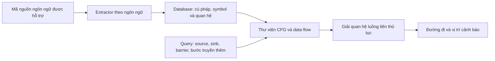
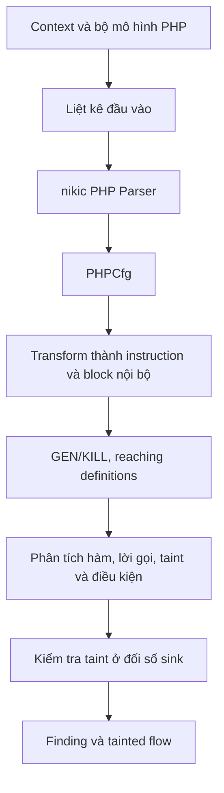
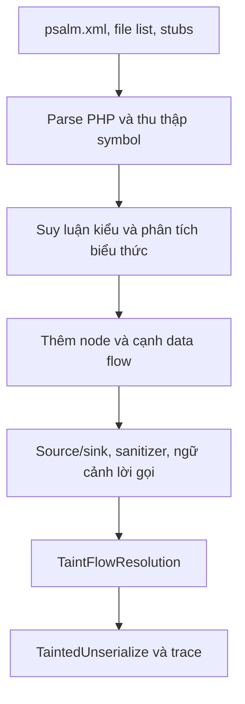
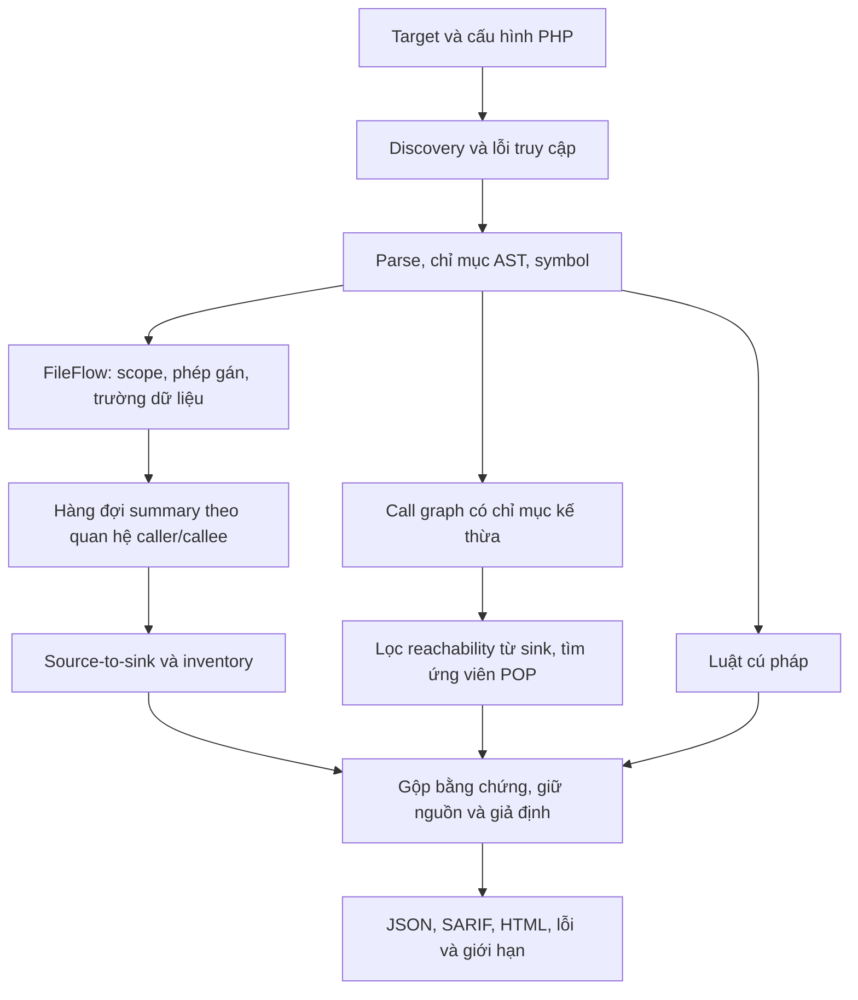

# Phân tích kiến trúc CodeQL, Progpilot, Psalm và áp dụng vào PHP Deserial SAST

## 1. Phạm vi và cách đọc kết quả

Phân tích này dựa trên **mã nguồn thực tế đã tải trong thư mục đồ án**, không suy diễn rằng một sản phẩm có tên SAST sẽ hỗ trợ mọi ngôn ngữ. Đối tượng của công cụ hiện tại vẫn là PHP insecure deserialization, các điều kiện dẫn tới PHP Object Injection và ứng viên chuỗi POP. SQL injection, XSS và các loại lỗi khác của công cụ đối chiếu được giữ trong báo cáo gốc nhưng không cộng vào số phát hiện deserialization.

Các phiên bản nguồn được đọc:

| Công cụ | Commit của bản nguồn cục bộ | Vai trò trong đánh giá |
| --- | --- | --- |
| CodeQL | `cf4d0e1e86600a863b481090dbf202abd1687c29` | Học kiến trúc và thuật toán; không chạy PHP |
| Progpilot | `38cb1e037ab487dead8677303fa65dd33e480772` | Chạy nguồn PHP với dependency Composer của nó |
| Psalm | `592d2061af6fcaded36b87b1c956c8e1eb8194fb` | Chạy nguồn PHP ở chế độ `--taint-analysis` |

Không coi kết quả của công cụ thứ hai là ground truth. Hai công cụ cùng cảnh báo vẫn có thể cùng sai; cả hai cùng bỏ sót cũng không chứng minh an toàn. Một cảnh báo `unserialize` cần được đọc cùng nguồn dữ liệu, options, caller, lớp được nạp và runtime. Chuỗi POP trong thư viện và endpoint deserialize đầu vào HTTP là hai loại bằng chứng khác nhau.

## 2. CodeQL

### 2.1. Cấu trúc và phạm vi hỗ trợ

Kho `codeql/` chứa các thư viện QL, truy vấn bảo mật, mô hình thư viện và ca kiểm thử theo ngôn ngữ. Các thư mục như `python/`, `java/`, `javascript/`, `cpp/`, `csharp/`, `go/`, `ruby/`, `rust/`, `swift/` chứa phần tương ứng. `shared/dataflow/` chứa thành phần luồng dữ liệu dùng chung; `docs/` giải thích mô hình dữ liệu và cách viết truy vấn.

README của kho phân biệt rõ kho thư viện/truy vấn với **CodeQL CLI và engine**, được phát hành riêng. Bản này không có PHP extractor/query pack. PHP cũng không có trong [danh sách ngôn ngữ được CodeQL hỗ trợ](https://codeql.github.com/docs/codeql-overview/supported-languages-and-frameworks/). Vì thế không có phép chạy PHP hợp lệ để đưa CodeQL vào bảng so sánh số lỗ hổng. Trạng thái đúng là `unsupported_php`, không phải `0 finding`.

### 2.2. Workflow



Extractor biến mã nguồn thành dữ liệu có quan hệ. Query diễn tả điều kiện cần tìm trên dữ liệu đó. Dạng `path-problem` có thể trả thêm đường đi từ source đến sink. Đây là khác biệt cơ bản so với chỉ tìm tên hàm nguy hiểm trong văn bản: một query taint kiểm tra quan hệ luồng, không chỉ sự xuất hiện của hai chuỗi ký tự trong cùng tệp.

### 2.3. Các thành phần mã nguồn đã đối chiếu

Trong [`DataFlow.qll`](../codeql/shared/dataflow/codeql/dataflow/DataFlow.qll), `InputSig` định nghĩa các loại node như `ParameterNode`, `ArgumentNode`, `ReturnNode`, `OutNode`, `PostUpdateNode`. Tham số, giá trị trả về và trạng thái đối tượng sau lời gọi được mô hình hóa riêng. Cách tổ chức này giúp xác định nơi dữ liệu đi vào/ra một lời gọi và tránh gộp mọi biến có cùng tên.

[`TaintTracking.qll`](../codeql/shared/dataflow/codeql/dataflow/TaintTracking.qll) bổ sung `defaultTaintSanitizer`, `defaultAdditionalTaintStep`, implicit read và các barrier vào data flow. Data flow thông thường theo dõi giá trị; taint có thể đi qua phép biến đổi dù giá trị không còn giống nguyên bản, ví dụ dữ liệu được giải mã hoặc ghép chuỗi. Sanitizer phải phù hợp loại sink đang xét.

Ví dụ cụ thể [`UnsafeDeserialization.ql`](../codeql/python/ql/src/Security/CWE-502/UnsafeDeserialization.ql) của **Python** import `UnsafeDeserializationFlow::PathGraph`, gọi `flowPath(source, sink)`, rồi xuất sink cùng source và thông điệp. Metadata của query ghi CWE-502, độ chính xác và mức độ bảo mật. Query này minh họa thiết kế, không phải luật PHP có thể sao chép nguyên văn sang công cụ hiện tại.

### 2.4. Điều áp dụng được

Công cụ hiện tại tiếp tục tách nhận diện source/sink khỏi giải luồng và trình bày kết quả. Summary của hàm đóng vai trò quan hệ giữa tham số, kết quả và sink; mỗi caller gắn tham số thực tế của nó vào summary thay vì dùng một taint toàn cục cho mọi lần gọi. Tìm POP được bổ sung reachability ngược từ sink, loại các nhánh không thể tới thao tác nguy hiểm trước khi duyệt đường đi. Việc cắt này giữ nguyên các đường đi tới sink đã tồn tại trong call graph.

Không gọi bản sửa là một triển khai CodeQL, không chuyển query Python thành luật PHP bằng cách đổi tên hàm, và không xem reachability trong call graph là bằng chứng kiểm soát được tham số của sink.

## 3. Progpilot

### 3.1. Cấu trúc

| Thành phần | Vai trò |
| --- | --- |
| `package/src/progpilot/Analyzer.php` | Điều phối liệt kê tệp, parse, biến đổi và phân tích |
| `Context.php`, `ContextInternalApi.php` | Trạng thái phân tích, cấu hình và giới hạn tài nguyên |
| `Transformations/Php/Transform.php` | Biến CFG PHP thành biểu diễn nội bộ của Progpilot |
| `Code/`, `Objects/` | Instruction, opcode, hàm, lớp, định nghĩa và trạng thái biến |
| `Dataflow/VisitorDataflow.php`, `Definitions.php` | Block, GEN/KILL và reaching definitions |
| `Analysis/VisitorAnalysis.php`, `TaintAnalysis.php` | Truyền taint, lời gọi, validator và sanitizer |
| `Analysis/SecurityAnalysis.php` | Kiểm tra đối số sink và dựng evidence |
| `uptodate_data/php/` | Dữ liệu source, sink, validator, sanitizer và framework |
| `Outputs/`, `Command/` | Kết quả, trace, giao diện CLI |

Composer của bản tải về yêu cầu PHP `>=8.3` và `ircmaxell/php-cfg`. Vì host chưa có PHP trong PATH, môi trường đánh giá dùng PHP trong Docker và cài dependency của chính kho nguồn này. Không chạy một bản Progpilot khác rồi gán kết quả cho commit đang đọc.

### 3.2. Luồng xử lý



Trong [`Analyzer.php`](../progpilot/package/src/progpilot/Analyzer.php), constructor tạo PHP parser rồi `PHPCfg\Parser`. `transformPhp()` chạy visitor biến đổi. `visitDataFlow()` tính quan hệ dữ liệu; `runFunctionAnalysis()` và `runAnalysisOfCurrentMyFile()` điều phối phân tích hành vi. `run()` nạp source/sink/validator/sanitizer mặc định và framework, xử lý namespace trước rồi phân tích các tệp.

[`VisitorDataflow.php`](../progpilot/package/src/progpilot/Dataflow/VisitorDataflow.php) xử lý opcode như `ENTER_FUNCTION`, `ENTER_BLOCK`, `LEAVE_BLOCK`, `LEAVE_FUNCTION`. Các tham số được đặt vào block đầu. Khi rời block, nó tính KILL; khi rời hàm, gọi `reachingDefs()` trên các block. Ý nghĩa thực tế: tại điểm `unserialize($x)`, cần tìm các phép gán của `$x` có thể đi tới đó, thay vì lấy mọi phép gán trong tệp.

Ví dụ `$x=$_GET['x']; $x='a:0:{}'; unserialize($x);` cần loại định nghĩa cũ khi phép gán an toàn chắc chắn ghi đè nó. Với phép gán có điều kiện, phải giữ cả khả năng nhánh không chạy. Với vòng lặp, giá trị ở một lần lặp có thể liên quan tới lần lặp tiếp theo; đây là lý do một hệ thống CFG hoàn chỉnh mạnh hơn so sánh vị trí dòng đơn thuần.

### 3.3. Nhận diện vấn đề bảo mật

[`sources.json`](../progpilot/package/src/uptodate_data/php/sources.json) khai báo các superglobal và nguồn khác, trong đó có những nguồn dữ liệu lưu trữ. [`sinks.json`](../progpilot/package/src/uptodate_data/php/sinks.json) khai báo `unserialize`, đối số thứ nhất, nhưng phân loại `attack: code_injection`, `cwe: CWE_95`. Adapter đánh giá vì thế lọc bằng **tên sink `unserialize`**, không chỉ lọc `CWE-502`.

[`TaintAnalysis.php`](../progpilot/package/src/progpilot/Analysis/TaintAnalysis.php) có xử lý validator dựa vào giá trị trả về và điều kiện đối số. [`SecurityAnalysis.php`](../progpilot/package/src/progpilot/Analysis/SecurityAnalysis.php) kiểm tra vị trí tham số được khai báo trong sink model, trạng thái taint và điều kiện an toàn, sau đó lần ngược quan hệ `taintedByDefs` để tạo trace.

Mô hình source/sink có ảnh hưởng trực tiếp tới kết quả. Dữ liệu framework không thể chỉ được đánh giá qua số lượng file JSON. Chẳng hạn bộ nguồn Symfony của bản này là danh sách rỗng; bộ Laravel chỉ chứa một mục đặc thù. Không thể suy ra rằng mọi request API của Drupal/Laravel/Symfony đã được mô hình hóa đầy đủ.

### 3.4. Hạn chế được kiểm chứng trong đợt chạy

Bộ mẫu ban đầu có namespace riêng cho mỗi tệp để tránh trùng helper. Progpilot không trả finding trên bộ này, trong khi bản mẫu tương đương dùng helper có tên duy nhất ở namespace global có kết quả. Các báo cáo calibration được lưu riêng. Do đó khả năng phân giải namespace/builtin của **bản đang kiểm tra** là một yếu tố gây bỏ sót; không dùng kết quả rỗng ban đầu làm bằng chứng công cụ chính xác.

Progpilot có giới hạn dung lượng tệp, số định nghĩa và thời gian trên tệp. Adapter dùng 50 MB/tệp, 10.000 định nghĩa, 60 giây/tệp và giới hạn toàn tiến trình riêng. `enumerated_files` là bộ đếm mà upstream trả về, không phải chứng nhận mọi tệp đều được phân tích đầy đủ. Warning, exception và timeout được lưu để người đọc không nhầm thành kết quả sạch.

### 3.5. Phần áp dụng

Các phép đọc biến tiếp tục gắn với phạm vi và định nghĩa đi tới điểm sử dụng. Bản sửa bổ sung phép gán giá trị phần tử `foreach`: trong thân vòng lặp, phần tử phải được lấy từ iterable; sau vòng lặp, phép gán được hợp nhất bảo thủ vì vòng lặp có thể không chạy. Ghi đè an toàn bên trong thân vòng lặp vẫn chặn taint cũ.

Đây chưa phải CFG tổng quát tương đương Progpilot. Các back-edge phức tạp, alias qua reference, destructor có điều kiện và heap liên đối tượng vẫn là giới hạn cần công bố. Bộ test có cả ca dương và ca âm để tránh tăng recall bằng cách làm mọi biến trở thành tainted.

## 4. Psalm

### 4.1. Cấu trúc

| Thành phần | Vai trò |
| --- | --- |
| `src/Psalm/Internal/Cli/` | Đọc cấu hình, xây dự án và chạy phân tích |
| `Internal/Scanner/`, `Storage/` | Thu thập khai báo và lưu metadata của lớp/hàm |
| `Internal/Analyzer/` | Kiểm tra statement/expression với thông tin kiểu và context |
| `Internal/Codebase/DataFlowGraph.php` | Nền tảng các cạnh luồng dữ liệu |
| `Internal/Codebase/TaintFlowGraph.php` | Source, sink, specialization, trạng thái dùng chung |
| `Internal/Codebase/TaintFlowResolution.php` | Giải đồ thị taint và dựng trace |
| `Internal/DataFlow/DataFlowNode.php`, `Path.php` | Node, vị trí và cạnh |
| `Type/TaintKind.php`, `Issue/TaintedUnserialize.php` | Loại taint và loại cảnh báo |
| `stubs/`, `dictionaries/`, `Plugin/` | Mô hình builtin, API và khả năng mở rộng |

### 4.2. Workflow



Phải bật `--taint-analysis`; kết quả kiểm tra kiểu thông thường không tương đương một lần dò taint. Thông tin kiểu giúp phân biệt `$request->get()` với một phương thức `get()` bất kỳ. Cùng tên phương thức không đủ để coi giá trị trả về là dữ liệu người dùng.

### 4.3. Cách giải luồng trong mã nguồn

[`TaintFlowGraph.php`](../psalm/src/Psalm/Internal/Codebase/TaintFlowGraph.php) tách các tập source, node, sink; có cấu trúc cho specialized calls, trạng thái dùng chung và stream. Điều này cho phép liên kết luồng qua tham số/kết quả trong khi giữ khác biệt giữa các lần gọi.

Phần chú thích kiến trúc đầu [`TaintFlowResolution.php`](../psalm/src/Psalm/Internal/Codebase/TaintFlowResolution.php) mô tả trạng thái gồm node đã tới, ngữ cảnh lời gọi và các phép gán còn mở. Taịnt được hợp nhất trên trạng thái; chỉ cần xử lý lại khi có thông tin mới. Phần thân lời gọi có thể được dùng chung bằng cách lưu taint giữ lại/thêm vào thay vì sao chép mọi đường đi. Các cạnh của array/property có thông tin giúp loại đường truyền sai giữa hai trường khác nhau. Trace được dựng từ thông tin predecessor khi cần báo cáo.

Đây là cơ sở để giảm lặp trong phân tích liên thủ tục: khi summary của hàm A đổi, chỉ các caller phụ thuộc A cần được đưa lại vào hàng đợi. Một chuỗi 40 hàm không nên bị bỏ sót chỉ vì hệ thống chọn một số vòng toàn dự án cố định là 24.

### 4.4. Source, sanitizer và phạm vi cảnh báo

Tài liệu [`security_analysis/index.md`](../psalm/docs/security_analysis/index.md) và mã nguồn mô tả nguồn HTTP, stream đầu vào, nguồn network và một số API khác. Taint có nhiều loại; an toàn cho SQL không đồng nghĩa an toàn cho deserialization. Type narrowing về số/boolean có thể loại khả năng mang serialized object, trong khi `base64_decode` không phải sanitizer.

Trong bộ mẫu chạy thực tế, Psalm cảnh báo `TaintedUnserialize` cả ở một số lời gọi có `allowed_classes=false` hoặc danh sách lớp rỗng. Phải đọc đây là việc dữ liệu không tin cậy đến API deserialize, không tự chuyển nó thành kết luận PHP tái tạo được gadget object. Phạm vi mục tiêu khác nhau giải thích một phần chênh lệch với công cụ chuyên POI.

### 4.5. Điều kiện môi trường

Bản Psalm cục bộ là nguồn phát triển, cần dependency Composer. Một lượt kiểm tra Monolog ban đầu bị exception `Could not get class storage for soapfault`. Đây là lỗi/missing model của môi trường phân tích, không phải finding của Monolog. Cấu hình chạy lại bổ sung `<enableExtensions><extension name="soap" /></enableExtensions>` để Psalm nạp stub thích hợp.

Runtime chạy analyzer là PHP trong image Composer; phiên bản PHP **của dự án đang được phân tích** được khai báo riêng qua `--php-version`. Không dùng phiên bản PHP của container để suy ra Phar có tự deserialize metadata trong ứng dụng đích hay không.

## 5. Rà soát công cụ hiện tại và thay đổi đã thực hiện

| Thành phần | Kết quả rà soát và thay đổi |
| --- | --- |
| `core/parser.py` | Giữ Tree-sitter; chuẩn hóa byte NUL trong chuỗi PHP có dấu nháy bằng byte cùng độ dài để parser không hiểu là EOF; vẫn trả mã nguồn gốc. Duy trì xử lý offset kiểu PHP cũ. |
| `core/ast_visitor.py` | Một lần lập chỉ mục thân phương thức thay cho sáu lượt duyệt; vẫn loại phạm vi closure/lớp lồng khỏi method bên ngoài. |
| `core/symbol_table.py` | Rà soát phân giải lớp/import/kế thừa; tiếp tục dùng bảng symbol hiện có. Chưa tuyên bố hỗ trợ mọi alias và nhiều namespace trong toàn bộ pipeline POP. |
| `core/dataflow.py` | Worklist theo dependency; hỗ trợ `foreach`, named arguments của builtin sink, `use function`, receiver có kiểu tham số; nguồn `filter_input` và stream đầu vào; cache ngữ cảnh nhánh. |
| `core/source_models.py` | Mô hình request Symfony/Illuminate hẹp, cần receiver type khớp; không dựa vào tên biến `$request` hay tên phương thức `get` đơn lẻ. |
| `core/taint_engine.py` | Dùng cùng bộ gắn đối số cho finding và sink inventory; phân biệt nguồn quan sát được, nguồn framework theo mô hình và giả định library mode; giảm confidence/severity khi return propagation chưa rõ. |
| `core/call_graph.py` | Chỉ mục namespace/lớp con/interface và cache method owner; báo số cạnh bị bỏ bởi giới hạn candidate thay vì âm thầm coi là đầy đủ. |
| `core/gadget_finder.py` | Duyệt ngược từ sink, tính khoảng cách ngắn nhất để loại nhánh không tới sink trong giới hạn độ sâu; giữ finding ở dạng ứng viên. |
| `scanner.py` | Đường dẫn không tồn tại thành lỗi discovery; công bố trạng thái worklist và giới hạn graph; tiếp tục ghi parse error và stage timing. |
| `rules/` | Đã đọc bộ matcher/engine và chạy `verify-rules`: 10 luật nạp hợp lệ. Luật cú pháp vẫn được ghi là `syntactic_rule_match`, không gán thành taint chứng minh được. |
| `models.py`, `reporters/` | Kiểm tra cách giữ evidence/metadata và xuất JSON/SARIF/HTML. Dùng schema metadata hiện có cho source assumption và trạng thái phân tích. |
| `llm/` | Kiểm tra đường gọi verifier, code slice và lỗi provider. Không bật LLM trong đánh giá để kết quả không phụ thuộc model/dịch vụ và không gửi mã testcase ra ngoài. |
| `cli.py`, `config.py`, CI | Giữ quy ước exit code có lỗi phân tích là `2`; bổ sung chạy test hồi quy vào CI. |

Thay đổi không được đánh giá bằng số dòng viết lại. Các phần đã có đúng vai trò được giữ; các lỗi có ca tái hiện và điểm nghẽn có bằng chứng được sửa tại thành phần dùng chung để mọi lần quét đều hưởng lợi.

### 5.1. Luồng công cụ sau sửa



### 5.2. Những giới hạn vẫn phải thể hiện

Phân tích hiện tại chưa có heap/alias/reference tổng quát, CFG đầy đủ cho mọi vòng lặp/exception, đầy đủ magic dispatch hoặc tất cả mô hình framework. Mô hình request theo kiểu không chứng minh đối tượng request được tạo từ đầu vào attacker. `allowed_classes=false` giảm nguy cơ tái tạo object nhưng không phải bằng chứng mọi cách dùng unserialize đều an toàn. Nguồn dữ liệu từ database/cache cần xem xét đường ghi dữ liệu; không được tự gắn mọi kết quả database thành HTTP input.

Các giới hạn candidate của POP và budget vẫn tồn tại, nhưng đã hiện rõ trong kết quả. Vì vậy một lần quét báo `call_graph_limit` có thể có taint finding hữu ích, song không đủ cơ sở tuyên bố đã duyệt hết chuỗi gadget. Không có finding cũng không chứng minh không có lỗ hổng.

## 6. Thiết kế kiểm tra và đối chiếu

### 6.1. Kiểm tra hành vi nhỏ

[`test_dataflow_regression.py`](../php_deserial_sast/tests/test_dataflow_regression.py) có các mẫu dương/âm cho nguồn request, ghi đè, trường mảng khác nhau, nhánh, restricted unserialize, named arguments, foreach, filter_input, stream, hàm chưa resolve, call-site riêng, import function, tham số object có kiểu, mô hình framework và đệ quy. Có ca chuỗi 40 hàm, chuỗi nhị phân có NUL, target không tồn tại và POP entry được kế thừa.

Trước sửa, bộ đầu tiên tái hiện 7 lỗi. Sau sửa, kiểm tra thêm các ca bảo vệ để không đánh đổi việc giảm bỏ sót bằng tăng báo nhầm ở biến bị ghi đè hoặc trường mảng an toàn. Các mẫu dùng để kiểm tra chính xác hành vi đã mô hình hóa, không đại diện cho toàn bộ không gian chương trình PHP.

### 6.2. Toàn bộ testcase

Tập đánh giá gồm Drupal 8.6.9, Laravel 5.6.29, hai thư mục Monolog, Saloon 3.0.0, TCPDF 6.2.22, WordPress 5.8.2 và XVWA. Bản baseline được chụp trước sửa. Bản cuối được chụp riêng, có SHA-256 của tệp nguồn, tránh lẫn mã trong lúc đang chỉnh sửa.

`scripts/evaluate_scanner.py` gọi từng lượt quét trong một subprocess riêng, ghi command, exit code, thời gian, lỗi, summary và JSON gốc. `scripts/evaluate_external.py` chạy nguồn Progpilot/Psalm trong Docker, giữ stdout/stderr và output gốc. Source testcase được đóng gói theo cùng danh sách phần mở rộng PHP rồi giải nén vào thư mục tạm trong container; không chạy ứng dụng testcase. Việc này giảm chi phí đọc lặp qua bind mount Windows. Dependency của analyzer được đóng trong image cục bộ từ đúng hai repo đã tải.

Cấu hình chung đưa cả mã test và vendor của testcase vào phạm vi. Vì thế cảnh báo trong fixture/test của dự án phải được tách khỏi endpoint production khi diễn giải. PHP mục tiêu được giả định 7.4 cho các dự án cũ và 8.1 cho Saloon/Monolog mới; đây là cấu hình thực nghiệm, không xác minh runtime triển khai của người dùng.

### 6.3. Đơn vị so sánh

Đối chiếu tại `(đường dẫn tương đối, dòng của sink unserialize)`. Công cụ hiện tại chỉ đưa finding của taint engine vào cột so sánh luồng; luật cú pháp, exposure library và ứng viên POP được thống kê riêng. Progpilot lọc sink `unserialize`; Psalm lọc `TaintedUnserialize`. Nhờ vậy, không so 100 cảnh báo XSS của một công cụ với 1 cảnh báo POI của công cụ khác rồi kết luận hơn/kém.

Timeout, exception, output không phải JSON và warning được giữ như trạng thái phân tích. Chỉ tính giao/khác biệt khi có báo cáo dùng được. Không suy ra precision/recall của toàn bộ dự án chỉ từ mức đồng thuận giữa ba scanner. Thời gian host Windows và container Linux, cũng như các lượt chạy đồng thời, chỉ mô tả đợt thực nghiệm này, không phải benchmark hiệu năng công bằng giữa các sản phẩm.

Kết quả định lượng và các vị trí cần đọc thủ công nằm trong [báo cáo đối chiếu](KET_QUA_DOI_CHIEU.md); raw data nằm dưới `reports/evaluation/`.

## 7. Tái lập

```powershell
py -3.12 -m unittest discover -s php_deserial_sast/tests -v
py -3.12 -m php_deserial_sast.cli verify-rules
py -3.12 scripts/evaluate_scanner.py optimized --snapshot
docker build -f scripts/Dockerfile.reference -t php-sast-references:local .
py -3.12 scripts/evaluate_external.py --label external-final --image php-sast-references:local --timeout 600
py -3.12 scripts/compare_results.py
```

Image cần các dependency đã cài trong `progpilot/vendor` và `psalm/vendor`. Các file `composer.lock` tại hai repo này ghi bộ phiên bản dependency dùng trong thực nghiệm. Báo cáo ghi hash image và commit nguồn để tránh nhầm với một bản phát hành khác.
