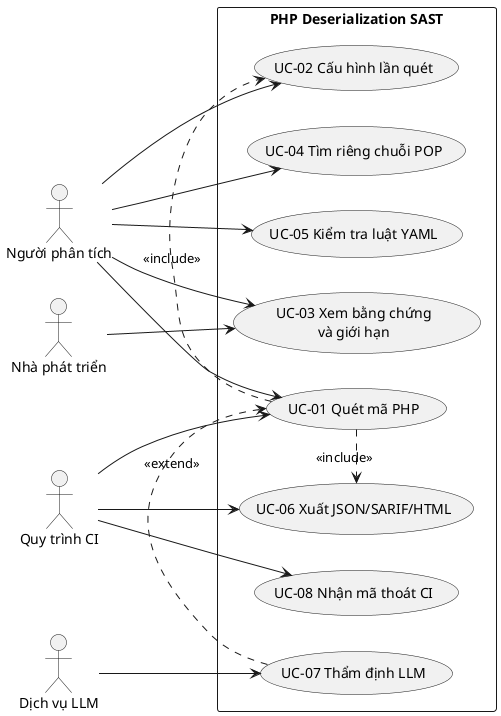
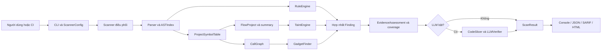
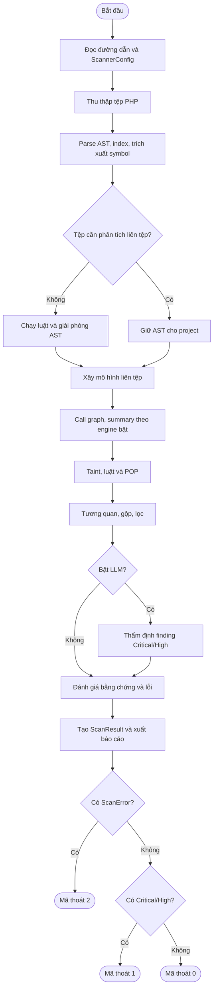
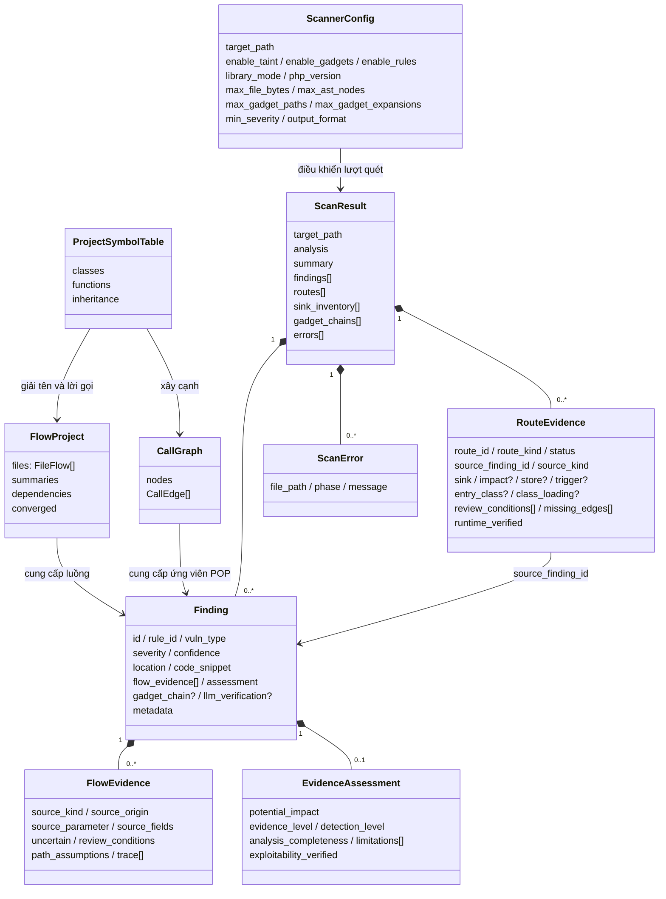

# PHÂN TÍCH VÀ THIẾT KẾ HỆ THỐNG CÔNG CỤ PHP INSECURE DESERIALIZATION SAST

> Phiên bản mô tả: mã nguồn tại `D:\đồ án`, ngày 28/10/2026. Tài liệu mô tả **hệ thống đang triển khai**, đồng thời tách các tiêu chí chất lượng cần kiểm chứng khỏi những khả năng đã được chứng minh. Có thể biên tập nội dung này thành mục phân tích thiết kế trong báo cáo đồ án tốt nghiệp.

## 1. Tổng quan bài toán và phạm vi

### 1.1. Bài toán

Trong PHP, `unserialize()` và các cơ chế khôi phục object tương tự có thể tạo ra object từ dữ liệu không đáng tin cậy. Khi class tương ứng được nạp, các magic method và các lời gọi tiếp theo có thể dẫn tới thao tác nguy hiểm. Một lời gọi giải tuần tự hóa riêng lẻ chưa đủ để kết luận có lỗ hổng: cần xét nguồn dữ liệu, đường truyền, điều kiện kiểm tra, khả năng khôi phục object, sự hiện diện của class/gadget và ngữ cảnh thực thi.

Công cụ **PHP Deserialization SAST** đọc mã nguồn PHP mà không chạy ứng dụng. Hệ thống kết hợp phân tích cú pháp, truy vết nguồn–đích, khớp luật và tìm ứng viên chuỗi POP (Property-Oriented Programming). Đầu ra là tập bằng chứng phục vụ rà soát thủ công hoặc tích hợp vào quy trình kiểm tra mã nguồn.

### 1.2. Mục tiêu thiết kế

1. Tìm các điểm giải tuần tự hóa và thao tác có thể liên quan đến metadata Phar trong toàn bộ mã PHP được chọn.
2. Phân biệt điểm gọi đáng chú ý về cú pháp với luồng dữ liệu có nguồn đã theo dõi được.
3. Tìm đường gọi tiềm năng từ magic method đến thao tác nguy hiểm, đồng thời ghi rõ giới hạn của suy luận POP.
4. Lưu vị trí, trace, giả định, điều kiện cần rà soát, lỗi phân tích và mức bao phủ trong báo cáo có cấu trúc.
5. Hoạt động trên dự án lớn bằng cách lập chỉ mục và giới hạn chi phí có khai báo, không âm thầm coi phần chưa quét là an toàn.

### 1.3. Ranh giới hệ thống

- **Đầu vào:** một tệp PHP hoặc thư mục dự án, cấu hình CLI, bộ luật YAML tích hợp hoặc tùy chỉnh, phiên bản PHP đích nếu biết. `composer.json` tại gốc có thể cung cấp ngữ cảnh package và gợi ý chế độ thư viện.
- **Xử lý:** phân tích tĩnh nội bộ bằng Python/Tree-sitter. Chỉ khi người dùng bật `--llm`, một số finding mức Critical/High mới được gửi tới dịch vụ LLM đã cấu hình để nhận đánh giá bổ sung.
- **Đầu ra:** console, JSON, SARIF hoặc HTML; mã thoát CLI; lỗi và giới hạn phân tích.
- **Ngoài phạm vi xác nhận tự động:** quyền truy cập endpoint thực tế, cấu hình runtime chưa được cung cấp, trạng thái object qua mọi request, khả năng điều khiển từng thuộc tính của payload, gadget được nạp ở mọi môi trường, và khai thác thành công.

Không có cơ sở dữ liệu ứng dụng trong kiến trúc hiện tại. Bảng ký hiệu, AST, đồ thị lời gọi và summary là dữ liệu **trong bộ nhớ của một lượt quét**; JSON/SARIF/HTML là hiện vật đầu ra.

## 2. Tác nhân, yêu cầu chức năng và phi chức năng

### 2.1. Tác nhân

| Tác nhân | Vai trò | Tương tác |
| --- | --- | --- |
| Người phân tích bảo mật | Chọn mã nguồn, cấu hình, xem xét bằng chứng | Gọi CLI, đọc finding và điều kiện cần xác minh |
| Nhà phát triển | Kiểm tra mã và sửa lỗi | Dùng vị trí mã, trace, khuyến nghị và báo cáo |
| Quy trình CI | Chạy quét tự động | Nhận tệp JSON/SARIF và mã thoát `0/1/2` |
| Dịch vụ LLM tùy chọn | Đánh giá bổ sung finding | Nhận lát cắt mã khi bật `--llm`; trả dữ liệu có cấu trúc |

### 2.2. Yêu cầu chức năng

| Mã | Yêu cầu | Đầu vào và kết quả quan sát được | Mức hiện thực |
| --- | --- | --- | --- |
| FR-01 | Chọn một tệp hoặc thư mục PHP và thu thập đệ quy | Danh sách tệp theo phần mở rộng hỗ trợ; lỗi duyệt thư mục được ghi | Đã có |
| FR-02 | Cấu hình phạm vi và tài nguyên | Bật/tắt taint, gadgets, rules; ngưỡng severity; giới hạn tệp, AST và ngân sách POP | Đã có |
| FR-03 | Phân tích cú pháp, lập chỉ mục AST và bảng ký hiệu | AST, class, method, function, quan hệ cần cho các engine | Đã có |
| FR-04 | Ghi nhận sink và phân tích luồng source–sink | Finding kèm trace/giả định và inventory của sink | Đã có trong phạm vi các nguồn, sink, cú pháp và framework được mô hình hóa |
| FR-05 | Phân tích liên hàm và điều khiển | Summary, lời gọi, phép gán, nhánh/loop được hỗ trợ; báo lỗi khi không hội tụ | Đã có, bao phủ có giới hạn |
| FR-06 | Tìm ứng viên chuỗi POP | Đường từ magic method qua call graph tới thao tác nguy hiểm; ngân sách và trạng thái chưa đầy đủ | Đã có |
| FR-07 | Nạp và kiểm tra luật YAML | `verify-rules`; kết quả khớp mẫu; lỗi luật được ghi riêng | Đã có cho tập con luật `search` |
| FR-08 | Tương quan, khử trùng lặp, phân cấp bằng chứng | Một finding đại diện cùng các đường thay thế, `assessment` và giới hạn | Đã có |
| FR-09 | Xuất báo cáo và mã thoát phù hợp | Console/JSON/SARIF/HTML; `scan` trả `0`, `1` hoặc `2` | Đã có |
| FR-10 | Thẩm định LLM tùy chọn | Kết quả LLM gắn vào finding Critical/High; lỗi dịch vụ được ghi | Đã có, mặc định tắt |
| FR-11 | Chạy riêng bộ tìm gadget | Lệnh `find-gadgets` | Đã có |
| FR-12 | Cung cấp ngữ cảnh phiên bản/runtime | Chế độ library, PHP version, package/advisory, Phar | Đã có dưới dạng giả định hoặc thông tin cấu hình; không tự xác minh runtime |

Các sink chính của engine luồng gồm `unserialize()`, `igbinary_unserialize()` và một số thao tác đường dẫn có khả năng kích hoạt metadata Phar theo phiên bản PHP; lời gọi `Phar::getMetadata()` tường minh được kiểm tra riêng. Bộ luật YAML bổ sung cảnh báo cú pháp, không thay thế phân tích taint.

### 2.3. Yêu cầu phi chức năng và cách kiểm chứng

| Mã | Thuộc tính | Tiêu chí thiết kế/kiểm chứng | Cơ chế hiện tại và giới hạn |
| --- | --- | --- | --- |
| NFR-01 | Tính đúng đắn có điều kiện | Finding phải nêu nguồn, sink, giả định và điều kiện chưa chứng minh; không đồng nhất mức nghiêm trọng với khả năng khai thác | `FlowEvidence`, `EvidenceAssessment`, `metadata` và `errors`; vẫn có âm tính/nhầm lẫn do mô hình tĩnh |
| NFR-02 | Tính đầy đủ có thể quan sát | Tệp bỏ qua, lỗi parse, lỗi rule, giới hạn AST/POP và summary không hội tụ phải hiện trong đầu ra | `ScanError`, `analysis.limits`, `analysis.performance`, `assessment.limitations` |
| NFR-03 | Khả năng mở rộng | Đo số tệp, byte, node, thời gian theo pha và tổng thời gian trên bộ ca lớn; so cùng cấu hình và cùng mã nguồn | AST index, giải phóng AST của tệp dữ liệu, summary theo nhu cầu, ngân sách đồ thị; chưa có cam kết thời gian cố định cho mọi dự án |
| NFR-04 | Khả năng tái lập | Với cùng nguồn, cấu hình và phiên bản công cụ, tập finding phải so sánh được theo rule/vị trí/bằng chứng | Sắp xếp tệp và finding; thời gian chạy và dịch vụ LLM không có tính tất định tương ứng |
| NFR-05 | An toàn dữ liệu | Không gửi mã tới dịch vụ ngoài khi LLM tắt; khóa API không nằm trong mã nguồn hoặc báo cáo | LLM mặc định tắt; key đọc từ biến môi trường/tham số; lỗi LLM che key khi có thể; người dùng cần kiểm soát quyền gửi mã |
| NFR-06 | Tính di động | Cài và chạy bằng Python theo khai báo package trên Windows/Linux/macOS | `pyproject.toml` khai báo Python ≥3.9 và dependency; cần kiểm thử riêng từng nền tảng |
| NFR-07 | Khả năng tích hợp | Đầu ra máy đọc được và mã thoát phân biệt finding nghiêm trọng với lần quét chưa đầy đủ | JSON, SARIF, mã thoát CLI; JSON ghi qua tệp tạm rồi thay thế nguyên tử |
| NFR-08 | Khả năng bảo trì | Engine, mô hình dữ liệu, luật và reporter tách vai trò; thay đổi phải qua kiểm thử hồi quy | Cấu trúc package và `tests/`; luật YAML chỉ hỗ trợ tập con cú pháp được kiểm tra |

Các tiêu chí ở bảng này là yêu cầu chất lượng và cách đánh giá, **không** phải lời khẳng định công cụ đã chứng minh độ chính xác tuyệt đối hoặc đạt một SLA thời gian trên mọi mã nguồn PHP.

## 3. Mô hình ca sử dụng

### 3.1. Biểu đồ use case

Biểu đồ sau thể hiện tác nhân và quan hệ chức năng. Các bước bên trong `scan` do hệ thống điều phối; người dùng không gọi trực tiếp từng engine.



### 3.2. Danh sách ca sử dụng

| Mã | Tên | Tác nhân chính | Tiền điều kiện | Hậu điều kiện |
| --- | --- | --- | --- | --- |
| UC-01 | Quét mã PHP | Người phân tích/CI | Đường dẫn tồn tại, package cài được | Có `ScanResult` hoặc lỗi được ghi; CLI trả mã thoát |
| UC-02 | Cấu hình lần quét | Người phân tích/CI | Có tham số CLI hợp lệ | `ScannerConfig` xác định engine, phiên bản, giới hạn, đầu ra |
| UC-03 | Xem bằng chứng và giới hạn | Người phân tích/nhà phát triển | Có báo cáo | Xác định vị trí, đường dữ liệu, điều kiện, thiếu bao phủ cần kiểm tra |
| UC-04 | Tìm riêng chuỗi POP | Người phân tích | Có mã PHP đích | Danh sách ứng viên gadget và thông tin liên quan |
| UC-05 | Kiểm tra luật YAML | Người phân tích | Có thư mục luật | Luật hợp lệ được liệt kê; luật lỗi được chỉ rõ |
| UC-06 | Xuất báo cáo | Người phân tích/CI | Scan hoàn thành hoặc có kết quả một phần | Tệp JSON/SARIF/HTML hoặc bản console |
| UC-07 | Thẩm định LLM | Người phân tích | Bật `--llm`, có provider phù hợp | Verdict bổ sung hoặc `ScanError` pha `llm` |
| UC-08 | Xử lý kết quả trong CI | Quy trình CI | Chạy lệnh `scan` | `0`: không có Critical/High và không có lỗi; `1`: có Critical/High; `2`: quét lỗi/chưa đầy đủ |

### 3.3. Đặc tả UC-01 — Quét mã PHP

- **Mục tiêu:** thu được báo cáo các điểm nghi vấn insecure deserialization trong một tệp hoặc dự án.
- **Kích hoạt:** `php-deserial-sast scan TARGET [OPTIONS]` hoặc `python -m php_deserial_sast.cli scan TARGET`.
- **Tiền điều kiện:** đường dẫn được CLI chấp nhận; các dependency Python đã được cài. Phiên bản PHP đích có thể chưa biết.
- **Luồng chính:** (1) CLI kiểm tra tùy chọn và tạo `ScannerConfig`; (2) scanner xác định ngữ cảnh package, thu thập tệp; (3) parse, lập AST index và bảng ký hiệu; (4) xây call graph và summary khi engine tương ứng bật; (5) chạy taint, luật và tìm POP; (6) hợp nhất finding, lọc severity, đánh giá bằng chứng; (7) thẩm định LLM nếu bật; (8) tạo `ScanResult`, xuất báo cáo và mã thoát.
- **Ngoại lệ:** lỗi duyệt/đọc tệp, parse có lỗi, tệp vượt giới hạn, luật không hợp lệ, budget POP hết, summary không hội tụ hoặc lỗi LLM được ghi trong `errors`. Báo cáo có thể còn các finding đã tìm được, nhưng mã thoát của `scan` là `2` khi có lỗi.
- **Quy tắc nghiệp vụ:** finding chỉ ra vị trí và bằng chứng tĩnh; `severity` không được đọc như xác nhận khai thác. Chế độ library là giả định caller bên ngoài; điều kiện runtime và guard chưa giải được phải giữ trong báo cáo.

### 3.4. Đặc tả UC-04 — Tìm ứng viên chuỗi POP

- **Kích hoạt:** `find-gadgets TARGET --max-depth N`.
- **Luồng chính:** xây bảng ký hiệu, call graph; lấy magic method làm điểm bắt đầu; duyệt đường gọi trong giới hạn độ sâu và ngân sách; tạo `GadgetChain` và finding ứng viên; hiển thị console.
- **Điều kiện đánh giá:** đường trong call graph không tự chứng minh object attacker tạo được, thuộc tính serialized điều khiển được, lớp được nạp hoặc sink reachable ở runtime. Các cạnh động và giới hạn ngân sách phải được đọc cùng kết quả.
- **Lưu ý giao diện hiện tại:** lệnh này hiển thị kết quả riêng; quy ước mã thoát `0/1/2` ở UC-08 được triển khai trong lệnh `scan`, không nên áp tự động cho `find-gadgets`.

### 3.5. Đặc tả UC-05 và UC-07

`verify-rules RULES_DIR` nạp từng luật YAML và kiểm tra các trường/pattern được hỗ trợ. Mỗi luật lỗi được ghi riêng để không che các luật hợp lệ khác; CLI báo lỗi khi thư mục luật không hợp lệ. Engine hiện hỗ trợ luật `search` với `pattern` hoặc `pattern-either` và một số điều kiện loại trừ/ngữ cảnh; **không** thực thi toàn bộ cú pháp Semgrep hay luật taint YAML.

Khi UC-07 được bật, scanner chỉ gửi finding Critical/High đã lọc tới LLM. `CodeSlicer` tạo ngữ cảnh mã, `LLMVerifier` gọi OpenAI, Gemini hoặc Ollama và kiểm tra JSON trả về. Verdict được gắn vào `llm_verification`; nó không tự thay severity hay biến suy luận tĩnh thành chứng minh khai thác.

## 4. Kiến trúc hệ thống và luồng xử lý

### 4.1. Phân rã thành phần

| Tầng/thành phần | Tệp chính | Trách nhiệm |
| --- | --- | --- |
| Giao diện và cấu hình | `cli.py`, `config.py` | Parse lệnh, tạo cấu hình, chọn reporter và mã thoát |
| Điều phối | `scanner.py` | Quản lý các pha, lỗi, timing, tương quan finding và kết quả chung |
| Phân tích cú pháp | `core/parser.py`, `core/ast_visitor.py` | Tree-sitter PHP, AST index, trích xuất khai báo |
| Mô hình chương trình | `core/symbol_table.py`, `core/control_flow.py`, `core/dataflow.py` | Bảng ký hiệu, CFG/scope, định nghĩa đạt tới điểm dùng, summary liên hàm |
| Phát hiện luồng | `core/taint_engine.py`, `core/source_models.py`, các mô hình framework/persistent store | Tìm nguồn–sink, trace, sink inventory, điều kiện cần rà soát |
| Phát hiện POP | `core/call_graph.py`, `core/gadget_finder.py`, `core/pop_evidence.py`, `core/deserialized_dispatch.py` | Đồ thị lời gọi, chuỗi ứng viên và chú giải điều kiện object/class |
| Luật | `rules/engine.py`, `rules/matcher.py`, `rules/definitions/*.yaml` | Nạp, kiểm tra, khớp mẫu AST |
| Đánh giá bằng chứng | `core/evidence.py`, `core/finding_coverage.py`, `core/finding_scope.py` | Mức phát hiện, giới hạn phụ thuộc, scope mã nguồn |
| Tùy chọn AI | `llm/slicer.py`, `llm/prompts.py`, `llm/verifier.py` | Chuẩn bị lát cắt, gửi và kiểm tra phản hồi |
| Mô hình và xuất báo cáo | `models.py`, `reporters/` | Pydantic schema, console/JSON/SARIF/HTML |

### 4.2. Biểu đồ thành phần



### 4.3. Luồng quét theo pha

1. **Khởi tạo:** scanner đọc `ScannerConfig`, phát hiện ngữ cảnh package, nạp YAML nếu bật và tạo parser. Mỗi lần gọi `scan()` đặt lại bảng ký hiệu để tránh rò dữ liệu từ lượt quét trước.
2. **Thu thập và parse:** duyệt đệ quy, lọc theo phần mở rộng PHP, tạo AST bằng Tree-sitter. `ASTIndex` duyệt cây một lần để tái sử dụng cho trích xuất khai báo và luật. Lỗi parser hoặc giới hạn tệp/node được ghi. Tệp chỉ chứa dữ liệu, không cần phân tích liên tệp, được chạy luật rồi giải phóng AST sớm.
3. **Mô hình liên tệp:** bảng ký hiệu tập hợp class/function/method. Call graph được tạo nếu bật POP. `FlowProject` tạo các `FileFlow`, summary liên hàm và quan hệ phụ thuộc nếu bật taint. Summary được tính theo nhu cầu ở cấu hình mặc định.
4. **Phát hiện:** `GadgetFinder` duyệt ứng viên từ magic method; `TaintEngine` duyệt sink trực tiếp và sink chuyển tiếp, nhóm các đường theo vị trí sink; `RuleEngine` đối chiếu mẫu AST. Một số kiểm tra Phar phụ thuộc phiên bản PHP và loại receiver.
5. **Tương quan:** scanner loại cảnh báo cú pháp đã được finding luồng mạnh hơn bao phủ, gộp finding trùng, giữ bằng chứng đường thay thế, lọc theo ngưỡng severity. Sink inventory được cập nhật khi caller liên tệp cung cấp nguồn.
6. **Đánh giá và bổ sung:** nếu bật LLM thì thẩm định finding phù hợp. Công cụ chú giải điều kiện POP, session dispatch, nguồn dữ liệu lưu bền, advisory package, phạm vi mã nguồn, bao phủ phụ thuộc và các giới hạn phân tích.
7. **Kết thúc:** tạo `ScanSummary`, `analysis`, `errors`, `findings`, `sink_inventory`, `gadget_chains`; reporter xuất kết quả. JSON được ghi vào tệp tạm cùng thư mục và thay thế đích sau khi hoàn tất.

### 4.4. Biểu đồ hoạt động của một lượt quét



## 5. Thiết kế dữ liệu dùng chung

### 5.1. Nguyên tắc

Hệ thống dùng hai lớp dữ liệu: **mô hình trung gian trong bộ nhớ** cho phân tích và **schema kết quả Pydantic** cho trao đổi/xuất báo cáo. AST node và summary là nội bộ, không được coi là một bảng lưu trữ dài hạn. Vị trí mã nguồn dùng byte offset trong phân tích và dòng/cột bắt đầu từ 1 trong báo cáo. `CodeLocation` giữ đường dẫn tệp và khoảng vị trí; nguồn byte gốc được giữ để trích snippet ngay cả khi parser phải chuẩn hóa một số cú pháp cũ theo cách bảo toàn offset.

### 5.2. Lược đồ khái niệm



### 5.3. Từ điển dữ liệu đầu ra

| Đối tượng/trường | Ý nghĩa | Quy tắc sử dụng |
| --- | --- | --- |
| `ScanResult.target_path` | Mục tiêu quét | Đường dẫn đã cấu hình; không phải phiên bản Git |
| `ScanResult.summary` | Số tệp, dòng, class, method, finding theo severity, chuỗi POP, thời gian | Số finding tính **sau** khử trùng lặp và lọc severity |
| `ScanResult.analysis` | Ngữ cảnh package, chế độ library, phiên bản PHP, giới hạn, thời gian theo pha, bao phủ | Dữ liệu giải thích điều kiện của lần quét |
| `ScanResult.findings[]` | Các cảnh báo/ứng viên | Một sink có thể có nhiều đường trong `flow_evidence` |
| `ScanResult.sink_inventory[]` | Điểm sink và trạng thái nguồn | Giữ cả sink chưa nối được nguồn đã theo dõi; không đồng nghĩa finding lỗ hổng |
| `ScanResult.gadget_chains[]` | Ứng viên đường POP | Có thể có cạnh động hoặc giả định thuộc tính; xem `steps` và metadata |
| `ScanResult.errors[]` | Lỗi/giới hạn theo pha và tệp | Bất kỳ lỗi nào làm `scan` trả mã `2` |
| `Finding.severity` | Tác động tiềm năng dùng ưu tiên xử lý | Độc lập với khả năng khai thác được chứng minh |
| `Finding.confidence` | Độ tin cậy của finding theo mô hình engine | Không thay thế `assessment` |
| `Finding.location` | Tệp, dòng và cột của điểm phát hiện | `start_line/start_col/end_line/end_col` bắt đầu từ 1 |
| `Finding.flow_evidence[]` | Từng đường source–sink giữ lại | Ghi loại nguồn, origin, trace, guard, giả định đường dẫn, cờ `uncertain` |
| `Finding.assessment` | Cách diễn giải chứng cứ | Tách impact, evidence, detection level, completeness và limitation |
| `Finding.metadata` | Bằng chứng chuyên biệt theo engine | Schema mở; consumer không nên giả định mọi finding đều có cùng khóa |
| `Finding.llm_verification` | Verdict bổ sung từ LLM | Có thể vắng mặt; không làm thay đổi kết quả phân tích tĩnh |

**Bổ sung dữ liệu route sau nâng cấp 29/10/2026.** `ScanResult.routes[]` chứa các `RouteEvidence` gắn với `Finding` nguồn qua `source_finding_id`. `route_kind` phân biệt `source_to_sink`, `candidate_gadget` và `candidate_session_dispatch`; `status` là `proven`, `conditional` hoặc `unknown` cho đúng cạnh tĩnh đang mô tả. `missing_edges[]` ghi điều kiện chưa chứng minh. Route qua session có `store`, `trigger`, `session_key`, `bootstrap_entrypoints` và `class_loading`; route đọc DB có thể ghi `persistent_table` và `persistent_column`. `route_id` là hash của danh tính ngữ nghĩa đã chuẩn hóa trong lần quét. `runtime_verified` luôn `False` trong quét tĩnh. `analysis.route_evidence` thống kê số route được giữ và các nhóm bị cắt bớt; `flow_evidence` vẫn là dữ liệu chi tiết của từng finding.

### 5.4. Quy tắc định danh, quan hệ và vòng đời

- Finding taint được nhóm theo tệp, dòng/cột, tên sink và đối số sink; ID dạng `FLOW-...` được tạo từ khóa vị trí. Finding luật dùng `rule_id` và vị trí; gadget có `chain_id`. Đầu ra không dùng một khóa cơ sở dữ liệu chung cho mọi engine.
- `ScanResult` chứa nhiều `Finding`, `SinkInventoryEntry`, `GadgetChain`, `ScanError`. Mỗi `Finding` có đúng một `CodeLocation`, có thể có nhiều `FlowEvidence`, tối đa một `EvidenceAssessment`, một `GadgetChain` hoặc một `LLMVerificationResult` tùy loại.
- Tập bằng chứng có giới hạn hiển thị. Khi số đường vượt ngưỡng, metadata ghi `flow_evidence_truncated`; danh sách hiện ra không phải toàn bộ đường phân tích.
- Mỗi lần `scan()` tạo lại bảng ký hiệu. Sau khi ghi báo cáo, AST, summary và đồ thị của lượt quét chỉ tồn tại trong tiến trình hiện tại; không có cơ chế lưu/chạy tiếp dựa vào cache phân tích trong package.

### 5.5. Phân tầng mức bằng chứng

`EvidenceAssessment` không thể rút gọn thành một nhãn High/Critical. Ba trục cần đọc riêng:

| Trục | Giá trị chính | Cách hiểu |
| --- | --- | --- |
| `evidence_level` | `syntactic_review`, `candidate_call_chain`, `assumed_api_flow`, `assumed_persistent_flow`, `modeled_source_flow`, `observed_source_flow`, `unresolved_flow` | Loại bằng chứng mà engine có |
| `detection_level` | `review_candidate`, `conditional_path`, `direct_untrusted_deserialization` | Mức kết luận tĩnh về đường giải tuần tự hóa |
| `analysis_completeness` | `within_model`, `limited` | Có hay không có giới hạn bổ sung được ghi nhận **trong mô hình hiện tại** |

`direct_untrusted_deserialization` chỉ được cấp khi có luồng request tới sink giải tuần tự hóa trực tiếp, không có guard/giả định đường dẫn/giới hạn đã biết theo quy tắc hiện tại. Nó là bằng chứng tĩnh về CWE-502, **không** khẳng định có gadget, payload hay khai thác runtime. `within_model` không có nghĩa đã bao phủ mọi hành vi PHP. `exploitability_verified` trong mô hình kết quả hiện tại mặc định là `False`.

## 6. Thiết kế xử lý phát hiện

### 6.1. Phân tích source–sink

Đơn vị xử lý là `FileFlow` trong `FlowProject`. Engine lập chỉ mục biểu thức, scope và phép gán; đánh giá luồng giá trị tại điểm dùng, không chỉ dò chuỗi văn bản. `Flow` giữ loại nguồn (`request`, nguồn framework được mô hình hóa, dữ liệu lưu bền, tham số API thư viện), điểm xuất phát, trường mảng, trace và trạng thái bất định. Summary của function truyền quan hệ giữa tham số, giá trị trả về và sink qua lời gọi liên hàm. CFG giúp loại đường không tới được hoặc định nghĩa không còn hiệu lực trong các cấu trúc đã hỗ trợ.

Tại sink, engine xét các đối số tương ứng, khả năng loại object qua `allowed_classes` hoặc guard, giả định về đường dẫn Phar và phiên bản PHP. Các đường được nhóm theo vị trí sink; đường đại diện dùng cho tiêu đề/severity, các đường khác giữ trong `flow_evidence` và thống kê metadata. `sink_inventory` ghi cả các sink không có nguồn đã chứng minh.

### 6.2. Phân tích ứng viên POP

`ProjectSymbolTable` cung cấp class, method, kế thừa và lời gọi. `CallGraph` tạo cạnh cho lời gọi rõ ràng và một số dạng dispatch động có kiểu/ứng viên; cạnh không giải được hoặc bị giới hạn được ghi nhận. `GadgetFinder` duyệt từ magic method/điểm vào phù hợp đến thao tác nguy hiểm trong giới hạn độ sâu, số đường và số cạnh. `GadgetChain.steps` giữ chuỗi vị trí và kiểu chuyển tiếp. Các chú giải sau đó bổ sung ứng viên class, thuộc tính serialized, điều kiện session dispatch hoặc nguồn dữ liệu lưu bền khi mô hình có bằng chứng. Đây là **đường ứng viên trong đồ thị**, chưa phải đường khai thác hoàn chỉnh.

### 6.3. Phân tích luật và tương quan

Rule engine nạp YAML, biên dịch mẫu theo tập con được hỗ trợ và khớp trên AST. Lỗi luật sinh `rule_load`, không được âm thầm coi là luật đã chạy. Bộ luật tích hợp hiện có 14 luật, trong đó có hai luật rà soát `session_decode()` và một luật cho thao tác nguy hiểm trực tiếp trong `__unserialize()`. Những luật này chỉ cung cấp ứng viên cần xem xét vì cấu hình session, nguồn dữ liệu và class được nạp chưa được chứng minh bằng mẫu cú pháp. Scanner đối chiếu vị trí để bỏ cảnh báo cú pháp tổng quát khi finding taint cùng sink đã cung cấp bằng chứng mạnh hơn, bỏ gợi ý `session_decode` tổng quát khi đã có mẫu request trực tiếp, và bỏ cảnh báo magic method đơn lẻ khi chuỗi POP liên quan đã bao phủ. Khử trùng lặp dựa vào rule/vị trí/sink/đích POP, đồng thời giữ đường thay thế và cờ cắt ngắn khi cần.

### 6.4. Trạng thái lỗi và giới hạn

Các pha lỗi gồm discovery, parse, rules, taint, summary, call graph, POP budget, loop fixed point, LLM và resource limit. Một số lỗi vẫn cho phép báo cáo các finding đã có; chúng làm giảm khả năng kết luận về phần còn lại. Vì vậy mã thoát `2` có ưu tiên hơn mã `1` trong lệnh `scan`. Chế độ `--max-file-mb` và `--max-ast-nodes` dùng để khống chế chi phí nhưng phần bị bỏ qua được đánh dấu chưa đầy đủ.

## 7. Giao diện, triển khai và truy vết kiểm chứng

### 7.1. Giao diện dòng lệnh và ví dụ

```powershell
php-deserial-sast scan D:\path\to\project --php-version 7.4 --severity info --format json --output report.json
php-deserial-sast scan D:\path\to\library --library-mode --format sarif --output report.sarif
php-deserial-sast find-gadgets D:\path\to\project --max-depth 6
php-deserial-sast verify-rules D:\path\to\rules
```

`--no-taint`, `--no-gadgets`, `--no-rules` tắt từng engine. `--framework-models` điều khiển mô hình dispatch có điều kiện. `--demand-summaries` là mặc định; `--eager-summaries` dùng để so sánh. Một số chế độ side effects/CFG còn gắn nhãn experimental. `--llm` là tùy chọn có thể gửi lát cắt mã nguồn tới provider đã chọn.

### 7.2. Ma trận truy vết yêu cầu tới mã và kiểm chứng

| Yêu cầu | Vị trí mã chính | Kiểm chứng phù hợp |
| --- | --- | --- |
| FR-01, FR-02 | `scanner.py::_collect_php_files`, `config.py`, `cli.py` | Tệp/thư mục, exclude, resource limit, lỗi discovery |
| FR-03 | `core/parser.py`, `core/ast_visitor.py`, `core/symbol_table.py` | Kiểm thử parse, symbol, AST index |
| FR-04, FR-05 | `core/dataflow.py`, `core/taint_engine.py`, `core/control_flow.py` | Ca source–sink, guard, alias, loop, liên hàm |
| FR-06 | `core/call_graph.py`, `core/gadget_finder.py` | Ca magic method, dispatch và giới hạn ngân sách |
| FR-07 | `rules/engine.py`, `rules/matcher.py`, YAML | `verify-rules` và kiểm thử pattern |
| FR-08 | `scanner.py::_deduplicate_findings`, `core/evidence.py` | Ca trùng sink, đường thay thế, mức bằng chứng |
| FR-09 | `models.py`, `reporters/`, `cli.py` | Schema JSON/SARIF, ghi tệp nguyên tử, mã thoát |
| FR-10 | `llm/slicer.py`, `llm/verifier.py` | Mock provider, JSON verdict và lỗi dịch vụ |

Tại thời điểm cập nhật báo cáo, bộ `unittest` của package có 196 ca đạt. Lượt quét đối chiếu trên 9 mục tiêu trong `testcase` giữ cùng 1.894 finding sau khi thêm luật, không có `ScanError` trong các JSON đó. Các mẫu mới được kiểm tra bằng ca dương/âm nhỏ; chúng chưa tạo finding mới trong 9 dự án trên. Đây là **kiểm thử hồi quy**, không phải phép đo precision/recall trên toàn bộ PHP hoặc bằng chứng xác nhận mọi finding là lỗ hổng thực tế.

## 8. Giới hạn thiết kế và hướng mở rộng

1. **Phụ thuộc runtime:** PHP version, cấu hình framework, khóa mã hóa, cách nạp class và quyền truy cập endpoint thường nằm ngoài mã được quét. Công cụ cần ghi giả định và ưu tiên kiểm chứng bằng cấu hình triển khai khi có dữ liệu, không tự nâng ứng viên thành lỗ hổng xác nhận.
2. **Luồng trạng thái liên request:** nguồn session/database có thể gợi ý liên kết giữa ghi và đọc, nhưng thứ tự request, cùng bản ghi và quyền ghi chưa được chứng minh tổng quát. Cần mô hình trạng thái và bằng chứng route/record có kiểm soát nếu mở rộng.
3. **Độ chính xác dataflow:** alias/heap phức tạp, include/callable động, reflection và hành vi framework ngoài mô hình có thể gây âm tính hoặc cảnh báo cần rà soát. Có thể mở rộng từng mô hình với ca kiểm thử độc lập và cờ giới hạn rõ ràng.
4. **Độ chính xác POP:** call graph over-approximate có thể nối cạnh không chạy được; thiếu bằng chứng thuộc tính serialized và điều kiện class loading có thể tạo ứng viên giả. Cần liên kết source, object state, property constraints và điều kiện runtime trước khi diễn giải là exploit path.
5. **Hiệu năng:** phân tích dự án lớn phụ thuộc số AST node, số cạnh và số đường sink. Nên tiếp tục đo theo pha trên cùng bộ nguồn, giữ manifest phiên bản mã, và chỉ tối ưu những đường nóng đã đo. Tăng budget có thể tăng bao phủ nhưng cũng tăng thời gian/bộ nhớ.

## 9. Nguồn đối chiếu trong dự án

- [README công cụ](../README.md) — chức năng, cài đặt, cách dùng, giới hạn.
- [CLI](../php_deserial_sast/cli.py), [cấu hình](../php_deserial_sast/config.py), [scanner](../php_deserial_sast/scanner.py) — giao diện và điều phối.
- [Mô hình dữ liệu](../php_deserial_sast/models.py), [đánh giá bằng chứng](../php_deserial_sast/core/evidence.py) — schema và cách diễn giải finding.
- [Parser](../php_deserial_sast/core/parser.py), [dataflow](../php_deserial_sast/core/dataflow.py), [taint engine](../php_deserial_sast/core/taint_engine.py) — phân tích source–sink.
- [Call graph](../php_deserial_sast/core/call_graph.py), [gadget finder](../php_deserial_sast/core/gadget_finder.py), [rule engine](../php_deserial_sast/rules/engine.py) — POP và luật.
- [Kết quả kiểm thử hồi quy](../reports/evaluation/retest-2026-10-28-cleanup/runs.json) — số liệu của lượt quét gần nhất; thư mục `reports/` là hiện vật thực nghiệm cục bộ, có thể không được đưa lên Git.
